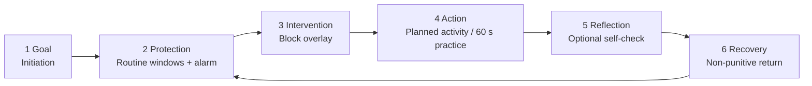

<callout icon="🧭" color="blue_bg">
	**Canonical source of truth** for Shanivar product strategy. Owner: Shanivar PM. Approved by founder Shubham Kumar on 17 Oct 2026 (strategy brief). Last updated: <mention-date start="2026-10-17"/>. Implementation details still need technical validation. Hypotheses are labelled **\[H\]** and are not requirements.
</callout>
<table_of_contents/>
# 1. Tagline and thesis
> **Protect. Become Aware. Enter Flow.**
**Thesis:** Shanivar helps people reduce automatic digital behavior, build consistent routines and develop awareness through small, actionable practices.
Three connected functions:
- **Protection:** interrupt unwanted digital behavior and make space for a deliberate choice.
- **Routine:** turn intentions into small, repeatable physical and behavioral actions.
- **Awareness / Sadhana:** observe thoughts, moods and urges, then apply that in daily life.
**Success test:** users need *less* intervention to act intentionally over time. We do not optimise for screen time blocked, alarms dismissed, meditation minutes or app opens.
**Long-term ambition \[H\]:** greater self-regulation and focused, intentional engagement with life. This is a thesis to validate through behavior and research, not a proven outcome.
Links to existing context: <mention-page url="https://app.notion.com/p/3ef10ae18c9f81029568dc70f636b1f6">Shanivar</mention-page> (project) · <mention-page url="https://app.notion.com/p/3fc10ae18c9f8199a5d5db25e0382907">4. Product truth: feature verification</mention-page> · <mention-page url="https://app.notion.com/p/3fc10ae18c9f81a09007dbbd63dd8c99">Shanivar Launch Campaign: Saturn's Wisdom</mention-page> · <mention-page url="https://app.notion.com/p/3fa10ae18c9f81558d9ee9041fd6cd6e">Mano Vijnana Research</mention-page>. Repo: `BookPress9/shanivar` (main @ 20fb519), `docs/decisions/`, `SHANIVAR_STANCE.md`, `docs/FINALIZATION_CHECKLIST.md`. No separate roadmap page existed in Notion, so §7 below is the current roadmap.
# 2. Competitive landscape and research findings
Each competitor does one function well. None we reviewed joins protection, routine and awareness in one loop. That is our opportunity \[H\]. We do **not** claim that competitors lack features.
<table header-row="true" fit-page-width="true">
	<tr>
		<td>Product</td>
		<td>What it does</td>
		<td>Takeaway for Shanivar</td>
	</tr>
	<tr>
		<td>**Opal**</td>
		<td>Focus sessions, recurring schedules, app limits and open limits, Pomodoro, weekly reports, **streaks**, Hard Mode, an "Always Allowed" essentials list. Uses AccessibilityService on Android 14+.[^https://play.google.com/store/apps/details?id=com.withopal.opal][^https://help.opalapp.com/]</td>
		<td>Essentials stay reachable, as in our DEV-10. We refuse AccessibilityService (0002) and streaks (0009), so our protection is weaker but more honest.</td>
	</tr>
	<tr>
		<td>**one sec**</td>
		<td>Intercepts a chosen app with a short delay plus the option to dismiss. PNAS 2023 (n=280, 6 weeks): 36% of open attempts dismissed, 57% fewer actual opens. In the controlled test, the **option to dismiss** had the strongest effect; the message alone did not work.[^https://www.pnas.org/doi/10.1073/pnas.2213114120]</td>
		<td>Friction plus a clear alternative choice is the evidence-backed core of our intervention. Their pause is breathing-led; **ours never paces the breath**.</td>
	</tr>
	<tr>
		<td>**Freedom**</td>
		<td>Cross-device blocking of apps, websites or the whole internet, with blocklists. Premium adds recurring sessions and Locked Mode.[^https://support.freedom.to/en/articles/13764747-what-s-included-in-free-and-premium-plans]</td>
		<td>Our scope is Android-only and app-only. Copy must say that browsers and other devices are not blocked.</td>
	</tr>
	<tr>
		<td>**Alarmy**</td>
		<td>Mission alarms (math, steps, squats, QR, photo), Wake Up Check, sleep sounds and tracking. Some missions and chaining are Pro.[^https://alar.my/en/blog/how-to-choose-alarmy-mission][^https://play.google.com/store/apps/details?id=droom.sleepIfUCan]</td>
		<td>This was the behavior reference for 0003 and 0007. Our movement dismissal always keeps an accessible path. No sleep tracking.</td>
	</tr>
	<tr>
		<td>**Routinery**</td>
		<td>Step-by-step routine timer with voice prompts, skip, extend and reorder, widgets, mood tracking.[^https://www.routinery.app/features]</td>
		<td>Small steps lower the cost of starting, and skipping is normal. That supports our non-punitive missed-step recovery.</td>
	</tr>
	<tr>
		<td>**Headspace**</td>
		<td>Large guided library, courses, sleep content, focus music, AI companion.[^https://www.headspace.com/app]</td>
		<td>Library breadth is not our game. One small practice tied to an action is.</td>
	</tr>
	<tr>
		<td>**Calm**</td>
		<td>Meditations, Sleep Stories, soundscapes, music, sleep check-in. A free tier plus Premium.[^https://support.calm.com/hc/en-us/articles/360044707294-What-Free-Content-is-Available-on-the-Calm-App]</td>
		<td>Content-heavy and sleep-led. We avoid any calm or sleep outcome claims.</td>
	</tr>
	<tr>
		<td>**Waking Up**</td>
		<td>Practice plus Theory and Life lessons; a 30-day intro course pairs a daily practice with a short lesson.[^https://help.wakingup.com/article/76-how-is-the-app-organized]</td>
		<td>Closest to our Sadhana plus deep study. Our difference is the explicit link from practice to a chosen daily action.</td>
	</tr>
	<tr>
		<td>**Insight Timer**</td>
		<td>Free library, a customisable unguided timer with bells and presets, talks and courses.[^https://help-app.insighttimer.com/support/solutions/articles/67000664719-what-is-insight-timer-]</td>
		<td>Unguided timers are a commodity. Our value has to come from the journey, not the timer.</td>
	</tr>
</table>
**Findings:** (1) Friction works best with a real alternative choice (one sec). (2) Most retention mechanics are streaks or content volume, both of which we rule out (0009, 0013). (3) Strong Android blocking leans on AccessibilityService, which we refuse (0002). So reliability and honesty about limits become product features. Repo research: `research/deep-foundation/COMPETITOR_PRODUCT_RESEARCH.md`, `research/shanivar-v1-alarm-focus-patterns.md`.
# 3. Target users and primary problems
<table header-row="true" fit-page-width="true">
	<tr>
		<td>Segment (primary goal)</td>
		<td>Primary problem</td>
		<td>First meaningful action (activation, proposed)</td>
	</tr>
	<tr>
		<td>**A. Digital distraction**</td>
		<td>Opens apps automatically and loses time without choosing to.</td>
		<td>At a first intervention, chooses an alternative (Not now, pause or practice).</td>
	</tr>
	<tr>
		<td>**B. Routine consistency**</td>
		<td>Intends a routine, breaks it, then quits after a missed day.</td>
		<td>Saves a routine and completes one planned activity or wake alarm, including after a missed day.</td>
	</tr>
	<tr>
		<td>**C. Meditation adherence**</td>
		<td>Starts meditating, then stops returning.</td>
		<td>Completes the 60-second first practice, then returns on a second local day.</td>
	</tr>
	<tr>
		<td>**D. Philosophical self-inquiry**</td>
		<td>Wants depth, but content stays abstract and is never applied.</td>
		<td>Completes a practice and links it to a "Choose" Routine window, or records practice without the app.</td>
	</tr>
</table>
Existing audience decisions still hold: younger self-directed users and family introductions to parents (0006, 0011); all ages intended, with an adult pilot first (0007).
# 4. Core product principles and non-goals
**Principles**
1. Smallest useful intervention first; experience before explanation (ST-002).
2. The user stays in charge: Skip, Change, End and Stop are always available; no irreversible lock (ST-003, ST-006, DEV-10).
3. Status must be truthful: "Active" only when the engine is actually enforcing (DEV-3, DEV-6).
4. Returning without punishment: missed days never erase history or create guilt (0009, Living Orbit).
5. Facts, not scores: attempts, seconds and outcomes. **Self-reports are never scores, capability evidence or health data** (0017, 0018).
6. Less dependence is success (ST-008): guidance reduces when the user chooses.
7. Device truth stays on the device: alarms, enforcement and local stop (0016).
**Non-goals (standing rules)**
- No breath pacing anywhere (DEV-39 removes the timed box-breathing script).
- No medical, therapeutic, energy or guaranteed-performance claims (SOP-05). "Energy flows where attention goes" stays internal (0018).
- No AccessibilityService and no Device Admin enforcement (0002). No "impossible to bypass" claims.
- No streaks, ranks, leaderboards or attainment levels (0009, 0013, ST-005).
- No teacher or lineage named in app or public copy (0015, ST-011). Named influences stay internal. A published translator credit (for example Wallis) is allowed.
- No separate audio product: audio is part of the meditation experience.
- No AI coach, content feed, social comparison or family surveillance in V1 (0009).
- Public copy may say the spine has **"33 sections"**.
# 5. Proposed end-to-end user journey
Goal → Protection → Intervention → Action → Reflection → Recovery. This extends the accepted V1 loop *Choose → Prepare → Protect → Notice → Review → Adjust → Leave* (0009); it does not replace it.

<table header-row="true" fit-page-width="true">
	<tr>
		<td>Step</td>
		<td>What exists in the repo (`android-app/.../nativeapp/`)</td>
		<td>Gap / ticket</td>
	</tr>
	<tr>
		<td>**1 Goal**</td>
		<td>Initiation V1 (`Initiation*.kt`, flag `INITIATION_V1`): guest flow, persisted checkpoints, 60 s first practice. When-then commitment (0010, `SankalpStore.kt`).</td>
		<td>No explicit segment/goal selection is stored. DEV-24, DEV-26, DEV-73, DEV-50.</td>
	</tr>
	<tr>
		<td>**2 Protection**</td>
		<td>Routine V3 (`Routine*.kt`): day plan, up to 8 protection windows, overnight windows, a wake alarm with movement/QR/photo/accessible dismissal (`Alarm*.kt`, 0003, 0008), boot/time-zone reconcile. Enforcement: `FocusGuardService` + `ForegroundAppBlocker` usage polling + `BlockOverlayActivity`.</td>
		<td>DEV-11, DEV-67, DEV-68, DEV-70, DEV-10. Device QA has never run (DEV-7).</td>
	</tr>
	<tr>
		<td>**3 Intervention**</td>
		<td>The block overlay offers Return, "Choose a short practice", "Take a one-minute pause" (`LocalPauseScreen.kt`), and says honestly that a brief flash is expected.</td>
		<td>**The choice is not recorded** (DEV-69). The "breathe" path needs a safety audit (DEV-89).</td>
	</tr>
	<tr>
		<td>**4 Action**</td>
		<td>Planned Routine activities; Sadhana Stage 1, 60 s (`SadhanaStage1.kt`, 0018); "Choose" linked to a Routine window (B5).</td>
		<td>Routine completion semantics are undefined (DEV-72). DEV-36, DEV-37 (audio is part of the practice).</td>
	</tr>
	<tr>
		<td>**5 Reflection**</td>
		<td>Optional Stage 1 self-check and `SessionReview.kt` ("What helped you stay with your plan?"), record, "practice without the app".</td>
		<td>Self-reports stay descriptive and are never scored. DEV-77 (optional prompt, later), DEV-54.</td>
	</tr>
	<tr>
		<td>**6 Recovery**</td>
		<td>Living Orbit (`LivingOrbit.kt`): append-only, and missed days never erase points. Guidance level reduces on user choice.</td>
		<td>No missed-step recovery flow yet (DEV-74). Lapsed-user journey (DEV-87, later).</td>
	</tr>
</table>
# 6. Customer Success outcome framework
**North Star: Weekly Intentional Actions Completed (WIAC).** WIAC counts the distinct occasions in a week when a user completes an action they deliberately selected through Shanivar, deduplicated across features. Full definition and dedupe rule: see the Measurement plan child page.
<callout icon="⚠️" color="yellow_bg">
	**No analytics exist today.** `SessionReview.kt` is local-only, so WIAC and every metric below are unmeasurable until DEV-65 (event contract) and DEV-69 (intervention choice) land. DEV-83 then verifies the events.
</callout>
Companion metrics: activation rate per segment; time to first value; routine completion rate; protection-window effectiveness (share of interventions resolved with an alternative choice); meditation return rate (second distinct local day); W1/W4 retention; recovery after missed days; self-reported intentionality and usefulness (reported separately, never scored); technical reliability (alarm fired on time, protection active while scheduled, sync failures).
**Guardrails:** higher engagement is not proof of awareness. Behavioral metrics are always paired with self-report, and measurement limits are stated. "Needs less intervention over time" is read as falling interventions per protected hour alongside stable or rising WIAC \[H\].
# 7. Product roadmap and prioritization
Rule: foundation, reliability, security and the first end-to-end journey come before any feature expansion. "Do not build more features simply because research identifies them."
<table header-row="true" fit-page-width="true">
	<tr>
		<td>Phase</td>
		<td>Goal</td>
		<td>Tickets</td>
		<td>Depends on</td>
	</tr>
	<tr>
		<td>**0 Foundation and security** (now)</td>
		<td>Safe repo, safe backend, a single backend</td>
		<td>DEV-8, DEV-40, DEV-41, DEV-42, DEV-43, DEV-44, DEV-15, DEV-14, DEV-19, DEV-17 (signing), DEV-79, DEV-80, DEV-89</td>
		<td>Founder: credential rotation (DEV-8), Supabase plan (DEV-41), DEV-40 decision</td>
	</tr>
	<tr>
		<td>**1 Reliability**</td>
		<td>Alarms and protection proven on real devices; failures visible</td>
		<td>DEV-7, DEV-67, DEV-70, DEV-71, DEV-75, DEV-10, DEV-53, DEV-45, DEV-47, DEV-38, DEV-55</td>
		<td>Phase 0; a physical device matrix incl. OEM phones</td>
	</tr>
	<tr>
		<td>**2 First E2E journey + measurement**</td>
		<td>Goal → protection → intervention → action → reflection → recovery, instrumented</td>
		<td>DEV-65, DEV-69, DEV-72, DEV-73, DEV-74, DEV-68, DEV-24, DEV-26, DEV-11, DEV-36, DEV-37, DEV-39, DEV-27–DEV-33, DEV-50, DEV-52, DEV-54, DEV-64, DEV-76</td>
		<td>DEV-65 before any instrumentation; content review manifests (DEV-34)</td>
	</tr>
	<tr>
		<td>**3 Release readiness**</td>
		<td>Gates 1–6 passed; Play closed test</td>
		<td>DEV-82, DEV-83, DEV-84, DEV-34, DEV-46, DEV-48, DEV-49, DEV-81, DEV-85, DEV-86, DEV-88, DEV-66, DEV-63</td>
		<td>Privacy notice update (0016); Play declarations; 12 testers × 14 days</td>
	</tr>
	<tr>
		<td>**Later** (after evidence)</td>
		<td>Expand only where data shows need</td>
		<td>DEV-16, DEV-22, DEV-23, DEV-13, DEV-51, DEV-77, DEV-78, DEV-87, DEV-12 (re-scope), DEV-18 (re-scope), DEV-9 (re-scope), DEV-25 (re-scope)</td>
		<td>WIAC baseline; founder decisions</td>
	</tr>
</table>
# 8. Technical dependencies and platform limitations
**Backend:** Supabase project `shanivar-prototype` (ap-south-1) is the only backend for the phone (DEV-40). Postgres RLS gives own-rows-only access (migration `20261013090000`). Auth is guest/anonymous plus invite-gated email OTP (DEV-48). The app is native Android, so **no frontend hosting is needed**. The Render Node API, with its inline DDL (0001) and the Gemini key (DEV-18), leaves the app path.
**Android limits:**
- **Usage access** (`PACKAGE_USAGE_STATS`): special access the user grants in Settings. Detection is polling, so **a brief flash of the blocked app is expected**. If access is revoked, enforcement ends silently unless DEV-70 surfaces it.
- **Accessibility service:** refused permanently (0002). Play limits it to genuine accessibility tools and requires a declaration.[^https://support.google.com/googleplay/android-developer/answer/10964491] We trade precision for Play survival and honesty.
- **Display over other apps** (`SYSTEM_ALERT_WINDOW`): needed for the overlay. The user can revoke it.
- **Exact alarms:** the manifest declares both `SCHEDULE_EXACT_ALARM` and `USE_EXACT_ALARM`. Play restricts `USE_EXACT_ALARM` to apps whose core function is an alarm or calendar.[^https://developer.android.com/develop/background-work/services/alarms] Confirm our declaration. Protection windows need `SCHEDULE_EXACT_ALARM`, which the user can deny.
- **Full-screen intent:** auto-granted on Android 14+ only to alarm and calling apps.[^https://support.google.com/googleplay/android-developer/answer/13392821] **Foreground service `specialUse`** needs a Play declaration.
- **Doze / App Standby:** they defer non-exact work. Alarms must use `setAlarmClock`/exact APIs; focus boundaries must re-arm after doze, reboot (`BootRescheduleReceiver`) and app update (B2).
- **OEM battery killers** (Xiaomi, Oppo/Realme, Vivo, Samsung, OnePlus) may kill `FocusGuardService`.[^https://dontkillmyapp.com/] **Untested.** This is the top reliability risk for our India-heavy audience.
- **Movement dismissal** depends on `TYPE_STEP_DETECTOR` and `ACTIVITY_RECOGNITION`. The accessible path is mandatory (0003).
- **Play production access:** a new personal account needs 12 opted-in testers for 14 continuous days.[^https://support.google.com/googleplay/android-developer/answer/14151465] Account deletion is also required (DEV-46).
- **Release builds launch no practice** until founder content-review manifests exist (B4, DEV-34).
# 9. Risks, assumptions and open questions
**Risks**
<table header-row="true" fit-page-width="true">
	<tr>
		<td>Risk</td>
		<td>Impact</td>
		<td>Mitigation / ticket</td>
	</tr>
	<tr>
		<td>No analytics: WIAC cannot be measured</td>
		<td>We would launch blind and could not test the thesis</td>
		<td>DEV-65 → DEV-69 → DEV-83 before the closed test</td>
	</tr>
	<tr>
		<td>Polling + overlay protection: visible flash; OEM battery savers untested</td>
		<td>Users see protection "fail"; trust loss</td>
		<td>Honest copy (already shown); DEV-7, DEV-70, DEV-71 on OEM devices</td>
	</tr>
	<tr>
		<td>Block-screen choice not recorded</td>
		<td>Protection-window effectiveness unmeasurable</td>
		<td>DEV-69</td>
	</tr>
	<tr>
		<td>Breathing\* screens and the overlay "breathe" path may pace breath</td>
		<td>Breaks a standing rule</td>
		<td>DEV-89 (with DEV-39)</td>
	</tr>
	<tr>
		<td>Leaked credentials still valid</td>
		<td>Security incident</td>
		<td>DEV-8 (founder), release blocker</td>
	</tr>
	<tr>
		<td>DEV-18 depends on Render, which DEV-40 retires</td>
		<td>Conflicting work; dead AI path</td>
		<td>Close or re-scope DEV-18 once DEV-40 is accepted</td>
	</tr>
	<tr>
		<td>Finance and wider Marketing have no epic</td>
		<td>Unit economics and acquisition untracked</td>
		<td>Founder decides the home (Q4); interim: child pages below and DEV-88</td>
	</tr>
	<tr>
		<td>DEV is a service desk: no epics, sprints or fix versions; comments are public</td>
		<td>Weak traceability</td>
		<td>DEV-20; epics run as "EPIC:" tasks</td>
	</tr>
	<tr>
		<td>Pooler host in 0004 is ap-northeast-2; the project is ap-south-1</td>
		<td>Wrong connection config</td>
		<td>Backend verifies during DEV-41</td>
	</tr>
	<tr>
		<td>Supabase Free pauses after 1 week of inactivity and has no backups</td>
		<td>Testers lose sync; no recovery</td>
		<td>Pro before production (DEV-41, Finance)</td>
	</tr>
</table>
**Unvalidated hypotheses**
- **\[H1\]** An intervention offering a concrete alternative (Not now / pause / 60 s practice) leads more people to choose deliberately than a plain block. *Test:* DEV-69 data; share of interventions resolved with an alternative, compared across a variant without the practice option during the closed test.
- **\[H2\]** Connecting protection → practice → routine increases WIAC over any single feature alone. *Test:* WIAC per user by how many functions they use, plus interviews; observational only at pilot size.
- **\[H3\]** Users need fewer interventions per protected hour over 4 weeks without lower WIAC. *Test:* within-user trend weeks 1–4 (DEV-85); confounded by novelty, so pair it with self-report.
- **\[H4\]** A 60-second first practice is a usable first dose (ST-002). *Test:* completion vs End rate and a second-day return.
- **\[H5\]** Non-punitive recovery (no streaks) raises return after a missed day. *Test:* recovery-after-missed-day rate, plus lapsed-user interviews (DEV-86).
- **\[H6\]** The four segments are distinct and identifiable at onboarding. *Test:* onboarding goal choice vs observed behavior, plus interviews.
- **\[H7\]** Polling-based protection is reliable enough on common Indian OEM phones. *Test:* DEV-7 / DEV-71 matrix with logged failures (DEV-70).
- **\[H8\]** Users will pay for Shanivar without paywalling essential controls. *Test:* willingness-to-pay interviews; no price set from competitors alone.
**Open questions** are listed in the Decision log (§11) as "Open".
# 10. Links to implementation, testing and launch tickets
<callout icon="🔗" color="gray_bg">
	**Populated from the Jira backlog step (17 Oct 2026, `/workspace/pm/backlog-2026-10-17.md`).** DEV is a service-desk project with no Epic type, so epics are "EPIC:" tasks and links are comments. Existing tickets keep their Jira status; PM notes appear in brackets where Jira lags. Every ticket follows brief §10 fields. The "First release?" column is the PM proposal for founder approval.
</callout>
Epics: [DEV-56 A Strategy & measurement](https://shanivar.atlassian.net/browse/DEV-56) · [DEV-57 B Protection](https://shanivar.atlassian.net/browse/DEV-57) · [DEV-58 C Routine](https://shanivar.atlassian.net/browse/DEV-58) · [DEV-59 D Sadhana](https://shanivar.atlassian.net/browse/DEV-59) · [DEV-60 E Security](https://shanivar.atlassian.net/browse/DEV-60) · [DEV-61 F QA & release](https://shanivar.atlassian.net/browse/DEV-61) · [DEV-62 G CS & growth](https://shanivar.atlassian.net/browse/DEV-62). Finance and wider Marketing have **no epic** yet (Q4).
Traceability chain per brief §2B: User problem → Hypothesis \[H\] → Requirement → Ticket → Test case (DEV-82 matrix) → Measured outcome (Measurement plan).
### [DEV-56](https://shanivar.atlassian.net/browse/DEV-56) — Epic A — Strategy and measurement
<table header-row="true" fit-page-width="true">
	<tr>
		<td>Ticket</td>
		<td>Title</td>
		<td>Owner</td>
		<td>Priority</td>
		<td>Status</td>
		<td>First release?</td>
	</tr>
	<tr>
		<td>[DEV-63](https://shanivar.atlassian.net/browse/DEV-63)</td>
		<td>Publish the canonical Notion page "Shanivar Product Thesis — Protection, Awareness & Flow" with decision log</td>
		<td>Founder approves; PM maintains (no team owner in §10 list)</td>
		<td>High</td>
		<td>Open (awaiting founder)</td>
		<td>Yes</td>
	</tr>
	<tr>
		<td>[DEV-64](https://shanivar.atlassian.net/browse/DEV-64)</td>
		<td>Map existing Shanivar features against the protect → act → reflect journey</td>
		<td>Shanivar Frontend</td>
		<td>High</td>
		<td>Open (awaiting founder)</td>
		<td>Yes</td>
	</tr>
	<tr>
		<td>[DEV-65](https://shanivar.atlassian.net/browse/DEV-65)</td>
		<td>Define the event dictionary, analytics contract and WIAC (North Star) computation</td>
		<td>Shanivar Backend</td>
		<td>Highest</td>
		<td>Open (awaiting founder)</td>
		<td>Yes (blocks WIAC)</td>
	</tr>
	<tr>
		<td>[DEV-66](https://shanivar.atlassian.net/browse/DEV-66)</td>
		<td>Set baselines, experiment design and an assumption register</td>
		<td>Customer Success</td>
		<td>Medium</td>
		<td>Open (awaiting founder)</td>
		<td>Yes</td>
	</tr>
</table>
### [DEV-57](https://shanivar.atlassian.net/browse/DEV-57) — Epic B — Protection and intentional choice
<table header-row="true" fit-page-width="true">
	<tr>
		<td>Ticket</td>
		<td>Title</td>
		<td>Owner</td>
		<td>Priority</td>
		<td>Status</td>
		<td>First release?</td>
	</tr>
	<tr>
		<td>[DEV-1](https://shanivar.atlassian.net/browse/DEV-1)</td>
		<td>FOCUS-1 A delayed START boundary can begin a 24-hour focus session</td>
		<td>Shanivar Frontend</td>
		<td>Highest</td>
		<td>Completed</td>
		<td>Done</td>
	</tr>
	<tr>
		<td>[DEV-2](https://shanivar.atlassian.net/browse/DEV-2)</td>
		<td>FOCUS-5 Window END calls releaseFocus() unconditionally — blocks multiple windows</td>
		<td>Shanivar Frontend</td>
		<td>High</td>
		<td>Completed</td>
		<td>Done</td>
	</tr>
	<tr>
		<td>[DEV-3](https://shanivar.atlassian.net/browse/DEV-3)</td>
		<td>FOCUS-6 A saved schedule is reported as armed without engine confirmation</td>
		<td>Shanivar Frontend</td>
		<td>High</td>
		<td>Completed</td>
		<td>Done</td>
	</tr>
	<tr>
		<td>[DEV-4](https://shanivar.atlassian.net/browse/DEV-4)</td>
		<td>FOCUS-4 Scheduled boundaries depend on a nullable in-process session</td>
		<td>Shanivar Frontend</td>
		<td>High</td>
		<td>Completed</td>
		<td>Done</td>
	</tr>
	<tr>
		<td>[DEV-5](https://shanivar.atlassian.net/browse/DEV-5)</td>
		<td>FOCUS-2 No overnight focus windows — sleep preparation is unreachable</td>
		<td>Shanivar Frontend</td>
		<td>High</td>
		<td>Completed</td>
		<td>Done</td>
	</tr>
	<tr>
		<td>[DEV-6](https://shanivar.atlassian.net/browse/DEV-6)</td>
		<td>FOCUS-3 All-day preset is 00:00–23:59 and copy implies persistent protection</td>
		<td>Shanivar Frontend</td>
		<td>Medium</td>
		<td>Completed</td>
		<td>Done</td>
	</tr>
	<tr>
		<td>[DEV-7](https://shanivar.atlassian.net/browse/DEV-7)</td>
		<td>Run the 8-check physical-device protocol — it has never executed once</td>
		<td>Shanivar Tester</td>
		<td>Highest</td>
		<td>Pending</td>
		<td>Yes (blocker)</td>
	</tr>
	<tr>
		<td>[DEV-10](https://shanivar.atlassian.net/browse/DEV-10)</td>
		<td>Keep essential-access stop, and keep no-snooze on the block screen</td>
		<td>Shanivar Frontend</td>
		<td>Highest</td>
		<td>Open</td>
		<td>Yes</td>
	</tr>
	<tr>
		<td>[DEV-21](https://shanivar.atlassian.net/browse/DEV-21)</td>
		<td>Reboot catch-up resumes local protection with no session — fixed on main</td>
		<td>Shanivar Frontend</td>
		<td>High</td>
		<td>Completed</td>
		<td>Done</td>
	</tr>
	<tr>
		<td>[DEV-67](https://shanivar.atlassian.net/browse/DEV-67)</td>
		<td>Audit protection capabilities and Android platform constraints</td>
		<td>Shanivar Frontend</td>
		<td>Highest</td>
		<td>Open (awaiting founder)</td>
		<td>Yes</td>
	</tr>
	<tr>
		<td>[DEV-68](https://shanivar.atlassian.net/browse/DEV-68)</td>
		<td>Specify protection-window behaviour and user controls</td>
		<td>Shanivar Frontend</td>
		<td>High</td>
		<td>Open (awaiting founder)</td>
		<td>Yes</td>
	</tr>
	<tr>
		<td>[DEV-69](https://shanivar.atlassian.net/browse/DEV-69)</td>
		<td>Record the intervention choice on the block overlay (on-device)</td>
		<td>Shanivar Frontend</td>
		<td>High</td>
		<td>Open (awaiting founder)</td>
		<td>Yes (blocks WIAC)</td>
	</tr>
	<tr>
		<td>[DEV-70](https://shanivar.atlassian.net/browse/DEV-70)</td>
		<td>Detect and surface protection failures (service killed, permission revoked)</td>
		<td>Shanivar Frontend</td>
		<td>Highest</td>
		<td>Open (awaiting founder)</td>
		<td>Yes</td>
	</tr>
	<tr>
		<td>[DEV-71](https://shanivar.atlassian.net/browse/DEV-71)</td>
		<td>QA suite: protection permissions, sessions, reboot and recovery on real devices</td>
		<td>Shanivar Tester</td>
		<td>Highest</td>
		<td>Open (awaiting founder)</td>
		<td>Yes</td>
	</tr>
</table>
### [DEV-58](https://shanivar.atlassian.net/browse/DEV-58) — Epic C — Routine and action execution
<table header-row="true" fit-page-width="true">
	<tr>
		<td>Ticket</td>
		<td>Title</td>
		<td>Owner</td>
		<td>Priority</td>
		<td>Status</td>
		<td>First release?</td>
	</tr>
	<tr>
		<td>[DEV-11](https://shanivar.atlassian.net/browse/DEV-11)</td>
		<td>Routine V3 — build the day plan, alarm, and protection. Sadhana waits.</td>
		<td>Shanivar Frontend</td>
		<td>High</td>
		<td>Work in progress</td>
		<td>Yes</td>
	</tr>
	<tr>
		<td>[DEV-12](https://shanivar.atlassian.net/browse/DEV-12)</td>
		<td>Align the Steady UI to its wireframe contract — built before the contract was visible</td>
		<td>Shanivar Frontend</td>
		<td>High</td>
		<td>Pending</td>
		<td>Re-scope (Sadhana V1 replaces Steady)</td>
	</tr>
	<tr>
		<td>[DEV-13](https://shanivar.atlassian.net/browse/DEV-13)</td>
		<td>Extract UI strings to strings.xml — blocks Hindi and all localisation</td>
		<td>Shanivar Frontend</td>
		<td>High</td>
		<td>Open</td>
		<td>Later</td>
	</tr>
	<tr>
		<td>[DEV-23](https://shanivar.atlassian.net/browse/DEV-23)</td>
		<td>Visual system: circles and connecting marks across the app</td>
		<td>Shanivar Frontend</td>
		<td>Medium</td>
		<td>Open</td>
		<td>Later</td>
	</tr>
	<tr>
		<td>[DEV-24](https://shanivar.atlassian.net/browse/DEV-24)</td>
		<td>Initiation step 1: onboarding draft persistence, account adapters, guest migration</td>
		<td>Shanivar Frontend</td>
		<td>Medium</td>
		<td>Work in progress</td>
		<td>Yes</td>
	</tr>
	<tr>
		<td>[DEV-26](https://shanivar.atlassian.net/browse/DEV-26)</td>
		<td>Initiation Compose screens from wireframe initiation-v1</td>
		<td>Shanivar Frontend</td>
		<td>Medium</td>
		<td>Work in progress</td>
		<td>Yes</td>
	</tr>
	<tr>
		<td>[DEV-52](https://shanivar.atlassian.net/browse/DEV-52)</td>
		<td>Routine schema v2: routine_plans revision/time_zone/practice_local, put_routine RPC with 409 on stale revision, one home for protection windows</td>
		<td>Shanivar Backend</td>
		<td>Medium</td>
		<td>Open</td>
		<td>Yes</td>
	</tr>
	<tr>
		<td>[DEV-53](https://shanivar.atlassian.net/browse/DEV-53)</td>
		<td>Device-truth tables: alarm_configs, alarm_observations, device_observations (device stays authority)</td>
		<td>Shanivar Backend</td>
		<td>Medium</td>
		<td>Open</td>
		<td>Yes</td>
	</tr>
	<tr>
		<td>[DEV-72](https://shanivar.atlassian.net/browse/DEV-72)</td>
		<td>Define routine completion semantics and make completion idempotent</td>
		<td>Shanivar Backend</td>
		<td>Highest</td>
		<td>Open (awaiting founder)</td>
		<td>Yes</td>
	</tr>
	<tr>
		<td>[DEV-73](https://shanivar.atlassian.net/browse/DEV-73)</td>
		<td>First meaningful action flow: new user completes one action without configuring the whole app</td>
		<td>Shanivar Frontend</td>
		<td>Highest</td>
		<td>Open (awaiting founder)</td>
		<td>Yes</td>
	</tr>
	<tr>
		<td>[DEV-74](https://shanivar.atlassian.net/browse/DEV-74)</td>
		<td>Missed-step recovery and non-punitive return</td>
		<td>Shanivar Frontend</td>
		<td>High</td>
		<td>Open (awaiting founder)</td>
		<td>Yes</td>
	</tr>
	<tr>
		<td>[DEV-75](https://shanivar.atlassian.net/browse/DEV-75)</td>
		<td>Verify alarm and notification behaviour on supported real devices</td>
		<td>Shanivar Tester</td>
		<td>Highest</td>
		<td>Open (awaiting founder)</td>
		<td>Yes</td>
	</tr>
</table>
### [DEV-59](https://shanivar.atlassian.net/browse/DEV-59) — Epic D — Sadhana and awareness
<table header-row="true" fit-page-width="true">
	<tr>
		<td>Ticket</td>
		<td>Title</td>
		<td>Owner</td>
		<td>Priority</td>
		<td>Status</td>
		<td>First release?</td>
	</tr>
	<tr>
		<td>[DEV-16](https://shanivar.atlassian.net/browse/DEV-16)</td>
		<td>DECISION: Sadhana Phase 2 — gamification and the intensive-practice boundary</td>
		<td>Founder (decision)</td>
		<td>High</td>
		<td>Pending</td>
		<td>Later (decision)</td>
	</tr>
	<tr>
		<td>[DEV-27](https://shanivar.atlassian.net/browse/DEV-27)</td>
		<td>Sadhana S1: practice domain + research-only lock (decision 0017)</td>
		<td>Shanivar Frontend</td>
		<td>Medium</td>
		<td>Work in progress</td>
		<td>Yes</td>
	</tr>
	<tr>
		<td>[DEV-28](https://shanivar.atlassian.net/browse/DEV-28)</td>
		<td>Sadhana S2: attempt timing + events (monotonic active seconds, interrupted on process death)</td>
		<td>Shanivar Frontend</td>
		<td>Medium</td>
		<td>Work in progress</td>
		<td>Yes</td>
	</tr>
	<tr>
		<td>[DEV-29](https://shanivar.atlassian.net/browse/DEV-29)</td>
		<td>Sadhana S3: record, reflection, independent practice, guidance preference, capability evidence</td>
		<td>Shanivar Frontend</td>
		<td>Medium</td>
		<td>Work in progress</td>
		<td>Yes</td>
	</tr>
	<tr>
		<td>[DEV-30](https://shanivar.atlassian.net/browse/DEV-30)</td>
		<td>Sadhana S4: Living Spine data (3 layers, SourceRecord, centres study-only)</td>
		<td>Shanivar Frontend</td>
		<td>Medium</td>
		<td>Work in progress</td>
		<td>Yes</td>
	</tr>
	<tr>
		<td>[DEV-31](https://shanivar.atlassian.net/browse/DEV-31)</td>
		<td>Sadhana S5: screens A - home, Living Spine, centre drawer, Path</td>
		<td>Shanivar Frontend</td>
		<td>Medium</td>
		<td>Work in progress</td>
		<td>Yes</td>
	</tr>
	<tr>
		<td>[DEV-32](https://shanivar.atlassian.net/browse/DEV-32)</td>
		<td>Sadhana S6: screens B - detail, prepare, player, return/reflection</td>
		<td>Shanivar Frontend</td>
		<td>Medium</td>
		<td>Work in progress</td>
		<td>Yes</td>
	</tr>
	<tr>
		<td>[DEV-33](https://shanivar.atlassian.net/browse/DEV-33)</td>
		<td>Sadhana S7: screens C - Record, Without app, Deep study + research boundary</td>
		<td>Shanivar Frontend</td>
		<td>Medium</td>
		<td>Work in progress</td>
		<td>Yes (deep study minimal)</td>
	</tr>
	<tr>
		<td>[DEV-34](https://shanivar.atlassian.net/browse/DEV-34)</td>
		<td>Sadhana S8: content review manifests, /v1 Sadhana API + sync, device/a11y QA (needs founder)</td>
		<td>Shanivar Frontend</td>
		<td>Medium</td>
		<td>Open</td>
		<td>Yes (blocker)</td>
	</tr>
	<tr>
		<td>[DEV-35](https://shanivar.atlassian.net/browse/DEV-35)</td>
		<td>Finalization B3–B8: sync outbox, content review gate, Choose↔Routine link, import initiation attempt, edit self-report minutes, a11y tests</td>
		<td>Shanivar Frontend</td>
		<td>Medium</td>
		<td>Done</td>
		<td>Done</td>
	</tr>
	<tr>
		<td>[DEV-36](https://shanivar.atlassian.net/browse/DEV-36)</td>
		<td>Sadhana Stage 1 (Spine base): attention practice, ambient frequency, one-tap check-in</td>
		<td>Shanivar Frontend</td>
		<td>Medium</td>
		<td>Open</td>
		<td>Yes (audio merged into practice)</td>
	</tr>
	<tr>
		<td>[DEV-37](https://shanivar.atlassian.net/browse/DEV-37)</td>
		<td>Spike: Stage 1 ambient frequency — sound sourcing, licensing, no health claims</td>
		<td>Shanivar Frontend</td>
		<td>Medium</td>
		<td>Open</td>
		<td>Yes (licence only)</td>
	</tr>
	<tr>
		<td>[DEV-39](https://shanivar.atlassian.net/browse/DEV-39)</td>
		<td>Bundled techniques.json contains timed box-breathing script and a nervous-system claim</td>
		<td>Shanivar Frontend</td>
		<td>Medium</td>
		<td>Open (PM: done, PR open)</td>
		<td>Yes</td>
	</tr>
	<tr>
		<td>[DEV-51](https://shanivar.atlassian.net/browse/DEV-51)</td>
		<td>Sadhana content tables (practice_definitions, content_review_manifests, source_records) with reviewed seed data + seed.sql</td>
		<td>Shanivar Backend</td>
		<td>Medium</td>
		<td>Open</td>
		<td>Later (bundled content first)</td>
	</tr>
	<tr>
		<td>[DEV-54](https://shanivar.atlassian.net/browse/DEV-54)</td>
		<td>Sadhana record schema alignment: practice_reflections table, self_reports/practice_attempts columns, orbit_events append-only with checks</td>
		<td>Shanivar Backend</td>
		<td>Medium</td>
		<td>Open</td>
		<td>Yes</td>
	</tr>
	<tr>
		<td>[DEV-76](https://shanivar.atlassian.net/browse/DEV-76)</td>
		<td>Map each initial practice to a user need, expected action and clarity check</td>
		<td>Customer Success</td>
		<td>Medium</td>
		<td>Open (awaiting founder)</td>
		<td>Yes</td>
	</tr>
	<tr>
		<td>[DEV-77](https://shanivar.atlassian.net/browse/DEV-77)</td>
		<td>Optional one-tap awareness prompt after a distraction or completed action</td>
		<td>Shanivar Frontend</td>
		<td>Low</td>
		<td>Open (awaiting founder)</td>
		<td>Later (optional)</td>
	</tr>
	<tr>
		<td>[DEV-78](https://shanivar.atlassian.net/browse/DEV-78)</td>
		<td>Connect relevant Mano Vijnana content to practical exercises</td>
		<td>Shanivar Frontend</td>
		<td>Low</td>
		<td>Open (awaiting founder)</td>
		<td>Later</td>
	</tr>
</table>
### [DEV-60](https://shanivar.atlassian.net/browse/DEV-60) — Epic E — Security, privacy and reliability
<table header-row="true" fit-page-width="true">
	<tr>
		<td>Ticket</td>
		<td>Title</td>
		<td>Owner</td>
		<td>Priority</td>
		<td>Status</td>
		<td>First release?</td>
	</tr>
	<tr>
		<td>[DEV-8](https://shanivar.atlassian.net/browse/DEV-8)</td>
		<td>Rotate the two leaked credentials — both verified still valid</td>
		<td>Founder (credential rotation)</td>
		<td>Highest</td>
		<td>Open</td>
		<td>Yes (blocker)</td>
	</tr>
	<tr>
		<td>[DEV-9](https://shanivar.atlassian.net/browse/DEV-9)</td>
		<td>Add a migration runner before the first knowledge table exists</td>
		<td>Shanivar Backend</td>
		<td>Highest</td>
		<td>Pending</td>
		<td>Re-scope (Render retired per DEV-40)</td>
	</tr>
	<tr>
		<td>[DEV-17](https://shanivar.atlassian.net/browse/DEV-17)</td>
		<td>Add release signing config and resolve api.thehybridmonk.com (currently NXDOMAIN)</td>
		<td>Shanivar Backend</td>
		<td>Medium</td>
		<td>Open</td>
		<td>Yes (signing); domain moot if Render retired</td>
	</tr>
	<tr>
		<td>[DEV-18](https://shanivar.atlassian.net/browse/DEV-18)</td>
		<td>Confirm whether GEMINI_API_KEY is set on Render — every AI estimate depends on it</td>
		<td>Shanivar Backend</td>
		<td>Medium</td>
		<td>Pending</td>
		<td>No (AI not in first release)</td>
	</tr>
	<tr>
		<td>[DEV-22](https://shanivar.atlassian.net/browse/DEV-22)</td>
		<td>Future sign-in options: phone, WhatsApp, SMS, authenticator and iOS app auth</td>
		<td>Shanivar Backend</td>
		<td>Medium</td>
		<td>Open</td>
		<td>Later</td>
	</tr>
	<tr>
		<td>[DEV-25](https://shanivar.atlassian.net/browse/DEV-25)</td>
		<td>Accounts + cloud sync: real providers, backend /v1, hosting (HIGH priority revisit)</td>
		<td>Shanivar Backend</td>
		<td>High</td>
		<td>Open</td>
		<td>Re-scope (Supabase; no frontend hosting)</td>
	</tr>
	<tr>
		<td>[DEV-38](https://shanivar.atlassian.net/browse/DEV-38)</td>
		<td>Sync outbox never queues own-practice self-reports, their edits/deletes, the imported onboarding attempt, or routine changes</td>
		<td>Shanivar Backend</td>
		<td>Medium</td>
		<td>Open (PM: done, PR open)</td>
		<td>Yes</td>
	</tr>
	<tr>
		<td>[DEV-40](https://shanivar.atlassian.net/browse/DEV-40)</td>
		<td>DECISION: Supabase is the only backend for the phone; retire the Render Node API from the app path</td>
		<td>Founder (decision)</td>
		<td>Medium</td>
		<td>Open</td>
		<td>Yes</td>
	</tr>
	<tr>
		<td>[DEV-41](https://shanivar.atlassian.net/browse/DEV-41)</td>
		<td>Supabase: add a staging project next to shanivar-prototype, and settle plan, backups and access for the live project</td>
		<td>Shanivar Backend</td>
		<td>Medium</td>
		<td>Open</td>
		<td>Yes</td>
	</tr>
	<tr>
		<td>[DEV-42](https://shanivar.atlassian.net/browse/DEV-42)</td>
		<td>Schema hygiene + RLS hardening on all sync tables: updated_at/created_at triggers, evidence_type checks, anon revoke, size caps, pgTAP tests</td>
		<td>Shanivar Backend</td>
		<td>Medium</td>
		<td>Open (PM: passed QA)</td>
		<td>Yes</td>
	</tr>
	<tr>
		<td>[DEV-43](https://shanivar.atlassian.net/browse/DEV-43)</td>
		<td>Apply Supabase migrations and Edge Functions through CI: staging on merge, prod on founder-approved release</td>
		<td>Shanivar Backend</td>
		<td>Medium</td>
		<td>Open</td>
		<td>Yes</td>
	</tr>
	<tr>
		<td>[DEV-44](https://shanivar.atlassian.net/browse/DEV-44)</td>
		<td>Android build flavours (staging/prod) carry Supabase URL and anon key from CI/local properties, never from git</td>
		<td>Shanivar Frontend</td>
		<td>Medium</td>
		<td>Open</td>
		<td>Yes</td>
	</tr>
	<tr>
		<td>[DEV-45](https://shanivar.atlassian.net/browse/DEV-45)</td>
		<td>Sync engine (Backend half): guest session, sender loop with retries/backoff/connectivity, dead-letter, conflict rules</td>
		<td>Shanivar Backend</td>
		<td>Medium</td>
		<td>Open (PM: in progress)</td>
		<td>Yes</td>
	</tr>
	<tr>
		<td>[DEV-46](https://shanivar.atlassian.net/browse/DEV-46)</td>
		<td>Edge Function delete-account: in-app account and synced-data deletion (plus client-side export)</td>
		<td>Shanivar Backend</td>
		<td>Medium</td>
		<td>Open</td>
		<td>Yes (Play requirement)</td>
	</tr>
	<tr>
		<td>[DEV-47](https://shanivar.atlassian.net/browse/DEV-47)</td>
		<td>Wire sync into the app (Frontend half): build the client from BuildConfig, guest sign-in at the Initiation guest step, flush triggers, quiet status line</td>
		<td>Shanivar Frontend</td>
		<td>Medium</td>
		<td>Open (PM: in progress)</td>
		<td>Yes</td>
	</tr>
	<tr>
		<td>[DEV-48](https://shanivar.atlassian.net/browse/DEV-48)</td>
		<td>Invite-code-gated email signup (Supabase Auth email OTP + server-side invite check)</td>
		<td>Shanivar Backend</td>
		<td>Medium</td>
		<td>Open</td>
		<td>Yes</td>
	</tr>
	<tr>
		<td>[DEV-50](https://shanivar.atlassian.net/browse/DEV-50)</td>
		<td>Onboarding/profile table (profiles + onboarding draft) and guidance_preferences</td>
		<td>Shanivar Backend</td>
		<td>Medium</td>
		<td>Open</td>
		<td>Yes</td>
	</tr>
	<tr>
		<td>[DEV-79](https://shanivar.atlassian.net/browse/DEV-79)</td>
		<td>Cross-user access test suite for every Supabase table, RPC and Edge Function</td>
		<td>Shanivar Backend</td>
		<td>Highest</td>
		<td>Open (awaiting founder)</td>
		<td>Yes (blocker)</td>
	</tr>
	<tr>
		<td>[DEV-80](https://shanivar.atlassian.net/browse/DEV-80)</td>
		<td>Sensitive logging, retention, deletion and backup review</td>
		<td>Shanivar Backend</td>
		<td>Highest</td>
		<td>Open (awaiting founder)</td>
		<td>Yes (blocker)</td>
	</tr>
	<tr>
		<td>[DEV-81](https://shanivar.atlassian.net/browse/DEV-81)</td>
		<td>Release, rollback and incident-response runbook</td>
		<td>Shanivar Backend</td>
		<td>High</td>
		<td>Open (awaiting founder)</td>
		<td>Yes</td>
	</tr>
</table>
### [DEV-61](https://shanivar.atlassian.net/browse/DEV-61) — Epic F — QA and release readiness
<table header-row="true" fit-page-width="true">
	<tr>
		<td>Ticket</td>
		<td>Title</td>
		<td>Owner</td>
		<td>Priority</td>
		<td>Status</td>
		<td>First release?</td>
	</tr>
	<tr>
		<td>[DEV-14](https://shanivar.atlassian.net/browse/DEV-14)</td>
		<td>Add crash reporting — a failed alarm currently leaves no trace anywhere</td>
		<td>Shanivar Frontend</td>
		<td>High</td>
		<td>Open</td>
		<td>Yes</td>
	</tr>
	<tr>
		<td>[DEV-15](https://shanivar.atlassian.net/browse/DEV-15)</td>
		<td>Add CI running backend and Android tests on push — two agents share this repo with no gate</td>
		<td>Shanivar Tester</td>
		<td>High</td>
		<td>Open</td>
		<td>Yes</td>
	</tr>
	<tr>
		<td>[DEV-19](https://shanivar.atlassian.net/browse/DEV-19)</td>
		<td>Git push cannot complete from a non-interactive session — credential manager needs a GUI dialog</td>
		<td>Shanivar Tester</td>
		<td>High</td>
		<td>Open</td>
		<td>Yes (tooling)</td>
	</tr>
	<tr>
		<td>[DEV-55](https://shanivar.atlassian.net/browse/DEV-55)</td>
		<td>E2E: phone-to-Supabase round trip against staging (automated nightly + physical-device checklist)</td>
		<td>Shanivar Tester</td>
		<td>Medium</td>
		<td>Open</td>
		<td>Yes</td>
	</tr>
	<tr>
		<td>[DEV-82](https://shanivar.atlassian.net/browse/DEV-82)</td>
		<td>Traceable test plan, AC-to-test matrix and defect register for all epics</td>
		<td>Shanivar Tester</td>
		<td>Highest</td>
		<td>Open (awaiting founder)</td>
		<td>Yes</td>
	</tr>
	<tr>
		<td>[DEV-83](https://shanivar.atlassian.net/browse/DEV-83)</td>
		<td>Verify analytics events match actual user actions</td>
		<td>Shanivar Tester</td>
		<td>High</td>
		<td>Open (awaiting founder)</td>
		<td>Yes</td>
	</tr>
	<tr>
		<td>[DEV-84](https://shanivar.atlassian.net/browse/DEV-84)</td>
		<td>End-to-end protect → act → reflect journey and regression suite</td>
		<td>Shanivar Tester</td>
		<td>High</td>
		<td>Open (awaiting founder)</td>
		<td>Yes</td>
	</tr>
</table>
### [DEV-62](https://shanivar.atlassian.net/browse/DEV-62) — Epic G — Customer Success and growth
<table header-row="true" fit-page-width="true">
	<tr>
		<td>Ticket</td>
		<td>Title</td>
		<td>Owner</td>
		<td>Priority</td>
		<td>Status</td>
		<td>First release?</td>
	</tr>
	<tr>
		<td>[DEV-49](https://shanivar.atlassian.net/browse/DEV-49)</td>
		<td>In-app feedback: write-only feedback table + submit_feedback RPC</td>
		<td>Shanivar Backend</td>
		<td>Medium</td>
		<td>Open</td>
		<td>Yes</td>
	</tr>
	<tr>
		<td>[DEV-85](https://shanivar.atlassian.net/browse/DEV-85)</td>
		<td>Activation and retention dashboard with goal segments</td>
		<td>Customer Success</td>
		<td>Medium</td>
		<td>Open (awaiting founder)</td>
		<td>Yes (minimal)</td>
	</tr>
	<tr>
		<td>[DEV-86](https://shanivar.atlassian.net/browse/DEV-86)</td>
		<td>Feedback and churn-reason taxonomy, interview guide and monthly product review</td>
		<td>Customer Success</td>
		<td>Medium</td>
		<td>Open (awaiting founder)</td>
		<td>Yes</td>
	</tr>
	<tr>
		<td>[DEV-87](https://shanivar.atlassian.net/browse/DEV-87)</td>
		<td>Lapsed-user recovery journey offering smaller commitments</td>
		<td>Customer Success</td>
		<td>Low</td>
		<td>Open (awaiting founder)</td>
		<td>Later</td>
	</tr>
	<tr>
		<td>[DEV-88](https://shanivar.atlassian.net/browse/DEV-88)</td>
		<td>Positioning doc and feature-claim verification checklist</td>
		<td>Sana (Marketing)</td>
		<td>Medium</td>
		<td>Open (awaiting founder)</td>
		<td>Yes</td>
	</tr>
</table>
### Fits no epic
<table header-row="true" fit-page-width="true">
	<tr>
		<td>Ticket</td>
		<td>Title</td>
		<td>Owner</td>
		<td>Priority</td>
		<td>Status</td>
		<td>First release?</td>
	</tr>
	<tr>
		<td>[DEV-20](https://shanivar.atlassian.net/browse/DEV-20)</td>
		<td>DECISION: sprints and Fix Version are unavailable — DEV is a service-desk project</td>
		<td>Founder</td>
		<td>High</td>
		<td>Open</td>
		<td>Yes (process)</td>
	</tr>
</table>
### Added after the backlog file
<table header-row="true" fit-page-width="true">
	<tr>
		<td>Ticket</td>
		<td>Title</td>
		<td>Owner</td>
		<td>Priority</td>
		<td>Status</td>
		<td>First release?</td>
	</tr>
	<tr>
		<td>[DEV-89](https://shanivar.atlassian.net/browse/DEV-89)</td>
		<td>Safety audit: Breathing\* screens and block-screen "breathe" action vs no-breath-pacing rule</td>
		<td>Shanivar Frontend + QA</td>
		<td>Medium</td>
		<td>Open</td>
		<td>Yes (blocker)</td>
	</tr>
</table># 11. Decision log
Seeded from `docs/decisions/0001–0018` and founder decisions of 17 Oct 2026. Repo files are **not** edited; changes are recorded here with the reason. Never overwrite a row: add a new one, or append to "What changed".
<table header-row="true" fit-page-width="true">
	<tr>
		<td>ID</td>
		<td>Decision</td>
		<td>Owner</td>
		<td>Status</td>
		<td>What changed / note</td>
		<td>Last updated</td>
	</tr>
	<tr>
		<td>[0001](https://github.com/BookPress9/shanivar/tree/main/docs/decisions)</td>
		<td>Schema changes run inline at boot (Render backend)</td>
		<td>Engineering</td>
		<td>Accepted 2026-09-12, with expiry</td>
		<td>**Change recorded 17 Oct:** the phone path now uses Supabase migrations (`supabase/migrations/`, DEV-43). 0001 still governs only the legacy Render API, which DEV-40 retires. DEV-9 needs re-scoping. File unchanged.</td>
		<td>2026-10-17</td>
	</tr>
	<tr>
		<td>[0002](https://github.com/BookPress9/shanivar/tree/main/docs/decisions)</td>
		<td>No Device Admin or AccessibilityService enforcement</td>
		<td>Founder / Engineering</td>
		<td>Accepted</td>
		<td>Reaffirmed. Polling + overlay; the brief flash is disclosed.</td>
		<td>2026-10-17</td>
	</tr>
	<tr>
		<td>[0003](https://github.com/BookPress9/shanivar/tree/main/docs/decisions)</td>
		<td>Movement-first alarm dismissal with a mandatory accessible path</td>
		<td>Founder</td>
		<td>Accepted</td>
		<td>Unchanged.</td>
		<td>2026-10-17</td>
	</tr>
	<tr>
		<td>[0004](https://github.com/BookPress9/shanivar/tree/main/docs/decisions)</td>
		<td>All DB connections through the Supavisor pooler</td>
		<td>Backend</td>
		<td>Accepted</td>
		<td>Unchanged. **Verify** that the pooler region matches ap-south-1 (0004 cites ap-northeast-2).</td>
		<td>2026-10-17</td>
	</tr>
	<tr>
		<td>[0005](https://github.com/BookPress9/shanivar/tree/main/docs/decisions)</td>
		<td>BookPress9/shanivar is the only repo</td>
		<td>Founder</td>
		<td>Accepted; steps 1 and 4 open</td>
		<td>Credential rotation still open (DEV-8).</td>
		<td>2026-10-17</td>
	</tr>
	<tr>
		<td>[0006](https://github.com/BookPress9/shanivar/tree/main/docs/decisions)</td>
		<td>One simple MVP: family introductions + younger self-use</td>
		<td>Founder</td>
		<td>Partially superseded by 0007</td>
		<td>Audiences retained in §3.</td>
		<td>2026-10-17</td>
	</tr>
	<tr>
		<td>[0007](https://github.com/BookPress9/shanivar/tree/main/docs/decisions)</td>
		<td>V1 includes alarms and focus modes</td>
		<td>Founder</td>
		<td>Accepted</td>
		<td>Unchanged.</td>
		<td>2026-10-17</td>
	</tr>
	<tr>
		<td>[0008](https://github.com/BookPress9/shanivar/tree/main/docs/decisions)</td>
		<td>Alarm recurrence recomputed after every fire</td>
		<td>Engineering</td>
		<td>Accepted</td>
		<td>Unchanged.</td>
		<td>2026-10-17</td>
	</tr>
	<tr>
		<td>[0009](https://github.com/BookPress9/shanivar/tree/main/docs/decisions)</td>
		<td>Return for the next conscious choice, not engagement</td>
		<td>Founder</td>
		<td>Accepted 2026-09-19</td>
		<td>Basis of §5 and WIAC. Non-goals unchanged.</td>
		<td>2026-10-17</td>
	</tr>
	<tr>
		<td>[0010](https://github.com/BookPress9/shanivar/tree/main/docs/decisions)</td>
		<td>Recurring focus schedules + when-then commitment</td>
		<td>Founder</td>
		<td>Accepted</td>
		<td>Unchanged.</td>
		<td>2026-10-17</td>
	</tr>
	<tr>
		<td>[0011](https://github.com/BookPress9/shanivar/tree/main/docs/decisions)</td>
		<td>VBT breathing as a scoped third pillar</td>
		<td>Founder</td>
		<td>Accepted scope direction</td>
		<td>**Change recorded 17 Oct:** the standing rule *no breath pacing* applies to every Breathing\* surface. Audit in DEV-89 / DEV-39. The tagline frames Awareness/Sadhana as the third function; whether Breathe & reset stays a separate Home entry is open (Q2).</td>
		<td>2026-10-17</td>
	</tr>
	<tr>
		<td>[0012](https://github.com/BookPress9/shanivar/tree/main/docs/decisions)</td>
		<td>Breathing session owner is process-scoped</td>
		<td>Engineering</td>
		<td>Accepted, implemented</td>
		<td>Unchanged.</td>
		<td>2026-10-17</td>
	</tr>
	<tr>
		<td>[0013](https://github.com/BookPress9/shanivar/tree/main/docs/decisions)</td>
		<td>Sadhana progression and gamification</td>
		<td>Founder</td>
		<td>PROPOSED</td>
		<td>Still open (DEV-16). Out of first release.</td>
		<td>2026-10-17</td>
	</tr>
	<tr>
		<td>[0014](https://github.com/BookPress9/shanivar/tree/main/docs/decisions)</td>
		<td>Routine + Sadhana shell; Routine V3</td>
		<td>Founder</td>
		<td>Accepted 2026-09-30</td>
		<td>Unchanged. Routine is the launch destination.</td>
		<td>2026-10-17</td>
	</tr>
	<tr>
		<td>[0015](https://github.com/BookPress9/shanivar/tree/main/docs/decisions)</td>
		<td>Sadhak and Hybrid Monk core ideology; naming rule</td>
		<td>Founder</td>
		<td>Accepted 2026-10-12</td>
		<td>**Change recorded 17 Oct:** teachers stay internal and are never named publicly; a published translator credit (for example Wallis) is allowed. **Conflict:** the launch-campaign page allows Shani and classical texts with attribution. Needs a founder ruling (Q3).</td>
		<td>2026-10-17</td>
	</tr>
	<tr>
		<td>[0016](https://github.com/BookPress9/shanivar/tree/main/docs/decisions)</td>
		<td>Initiation V1 wireframe: accounts + cloud sync at launch</td>
		<td>Founder</td>
		<td>Accepted 2026-10-12</td>
		<td>**Change recorded 17 Oct:** the backend is Supabase `shanivar-prototype` (ap-south-1). The native app needs no frontend hosting, which narrows DEV-25. Which sign-in methods ship in the first release is open (Q5). Privacy notice must be updated before release.</td>
		<td>2026-10-17</td>
	</tr>
	<tr>
		<td>[0017](https://github.com/BookPress9/shanivar/tree/main/docs/decisions)</td>
		<td>Sadhana V1 wireframe adopted</td>
		<td>Founder</td>
		<td>Proposed / adopted as design source</td>
		<td>**Change recorded 17 Oct:** "33 sections" of the spine may be said publicly.</td>
		<td>2026-10-17</td>
	</tr>
	<tr>
		<td>[0018](https://github.com/BookPress9/shanivar/tree/main/docs/decisions)</td>
		<td>Sadhana Stage 1: base of the spine</td>
		<td>Founder</td>
		<td>Adopted; 2 flags open</td>
		<td>**Change recorded 17 Oct:** self-reports are never scores or health data (reaffirmed). Audio is part of the meditation experience (DEV-36/37: no separate audio feature, no frequency claims). The "energy" line stays internal; public wording is still open.</td>
		<td>2026-10-17</td>
	</tr>
	<tr>
		<td>F-01</td>
		<td>Tagline "Protect. Become Aware. Enter Flow." and the product thesis</td>
		<td>Founder</td>
		<td>Accepted 2026-10-17</td>
		<td>New. Source: strategy brief.</td>
		<td>2026-10-17</td>
	</tr>
	<tr>
		<td>F-02</td>
		<td>Standing claims rules: no breath pacing; no medical, therapeutic, energy or guaranteed-performance claims</td>
		<td>Founder</td>
		<td>Accepted 2026-10-17</td>
		<td>New. Applies to app, site, store and social.</td>
		<td>2026-10-17</td>
	</tr>
	<tr>
		<td>F-03</td>
		<td>Supabase is the only backend for the phone; retire Render from the app path</td>
		<td>Founder</td>
		<td>Direction given 2026-10-17; DEV-40 still Open in Jira</td>
		<td>Close or re-scope DEV-18 and DEV-9 once DEV-40 is accepted.</td>
		<td>2026-10-17</td>
	</tr>
	<tr>
		<td>F-04</td>
		<td>North Star = WIAC, paired with self-report; no engagement-only metrics</td>
		<td>Founder / CS</td>
		<td>Accepted 2026-10-17</td>
		<td>Measurement plan child page.</td>
		<td>2026-10-17</td>
	</tr>
	<tr>
		<td>F-05</td>
		<td>Prioritise foundation, reliability, security and the first E2E journey before feature expansion</td>
		<td>Founder</td>
		<td>Accepted 2026-10-17</td>
		<td>Roadmap §7.</td>
		<td>2026-10-17</td>
	</tr>
	<tr>
		<td>F-06</td>
		<td>No team implements a major interpretation of the thesis without recording it here</td>
		<td>Founder / PM</td>
		<td>Accepted 2026-10-17</td>
		<td>Process rule.</td>
		<td>2026-10-17</td>
	</tr>
</table>
**Open questions (founder)**
<table header-row="true" fit-page-width="true">
	<tr>
		<td>#</td>
		<td>Question</td>
		<td>Owner</td>
		<td>Status</td>
		<td>Last updated</td>
	</tr>
	<tr>
		<td>Q1</td>
		<td>Approve the first-release scope (§7 Phases 0–3) and confirm that DEV-40 is accepted, so DEV-18 and DEV-9 can be closed or re-scoped.</td>
		<td>Founder</td>
		<td>Open</td>
		<td>2026-10-17</td>
	</tr>
	<tr>
		<td>Q2</td>
		<td>Does Breathe & reset (0011) stay a separate entry, or fold into Sadhana under "audio merged into meditation"? DEV-89 outcome feeds this.</td>
		<td>Founder</td>
		<td>Open</td>
		<td>2026-10-17</td>
	</tr>
	<tr>
		<td>Q3</td>
		<td>Naming conflict: may public copy reference Shani and classical texts with attribution (campaign page) under 0015's rule?</td>
		<td>Founder</td>
		<td>Open</td>
		<td>2026-10-17</td>
	</tr>
	<tr>
		<td>Q4</td>
		<td>Where do Finance and wider Marketing live: new epics or Epic G? Who owns them?</td>
		<td>Founder</td>
		<td>Open</td>
		<td>2026-10-17</td>
	</tr>
	<tr>
		<td>Q5</td>
		<td>First-release sign-in: guest + invite-gated email OTP only, or Google too (0016)? And Supabase Free vs Pro before testers (DEV-41)?</td>
		<td>Founder</td>
		<td>Open</td>
		<td>2026-10-17</td>
	</tr>
	<tr>
		<td>Q6</td>
		<td>Carried over: spine counting direction; progression sign-off; content reviews / source verification (DEV-34); NASA image comfort; public wording for the Stage 1 "energy" line; the safety reading of ST-010.</td>
		<td>Founder</td>
		<td>Open</td>
		<td>2026-10-17</td>
	</tr>
</table>