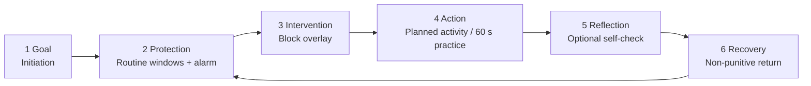

# 5. Proposed end-to-end user journey
Goal → Protection → Intervention → Action → Reflection → Recovery. This extends the accepted V1 loop *Choose → Prepare → Protect → Notice → Review → Adjust → Leave* (0009); it does not replace it.

<table header-row="true" fit-page-width="true">
	<tr>
		<td>Step</td>
		<td>What exists in the repo (`android-app/.../nativeapp/`)</td>
		<td>Gap / ticket</td>
	</tr>
	<tr>
		<td>**1 Goal**</td>
		<td>Initiation V1 (`Initiation*.kt`, flag `INITIATION_V1`): guest flow, persisted checkpoints, 60 s first practice. When-then commitment (0010, `SankalpStore.kt`).</td>
		<td>No explicit segment/goal selection is stored. DEV-24, DEV-26, DEV-73, DEV-50.</td>
	</tr>
	<tr>
		<td>**2 Protection**</td>
		<td>Routine V3 (`Routine*.kt`): day plan, up to 8 protection windows, overnight windows, a wake alarm with movement/QR/photo/accessible dismissal (`Alarm*.kt`, 0003, 0008), boot/time-zone reconcile. Enforcement: `FocusGuardService` + `ForegroundAppBlocker` usage polling + `BlockOverlayActivity`.</td>
		<td>DEV-11, DEV-67, DEV-68, DEV-70, DEV-10. Device QA has never run (DEV-7).</td>
	</tr>
	<tr>
		<td>**3 Intervention**</td>
		<td>The block overlay offers Return, "Choose a short practice", "Take a one-minute pause" (`LocalPauseScreen.kt`), and says honestly that a brief flash is expected.</td>
		<td>**The choice is not recorded** (DEV-69). The "breathe" path needs a safety audit (DEV-89).</td>
	</tr>
	<tr>
		<td>**4 Action**</td>
		<td>Planned Routine activities; Sadhana Stage 1, 60 s (`SadhanaStage1.kt`, 0018); "Choose" linked to a Routine window (B5).</td>
		<td>Routine completion semantics are undefined (DEV-72). DEV-36, DEV-37 (audio is part of the practice).</td>
	</tr>
	<tr>
		<td>**5 Reflection**</td>
		<td>Optional Stage 1 self-check and `SessionReview.kt` ("What helped you stay with your plan?"), record, "practice without the app".</td>
		<td>Self-reports stay descriptive and are never scored. DEV-77 (optional prompt, later), DEV-54.</td>
	</tr>
	<tr>
		<td>**6 Recovery**</td>
		<td>Living Orbit (`LivingOrbit.kt`): append-only, and missed days never erase points. Guidance level reduces on user choice.</td>
		<td>No missed-step recovery flow yet (DEV-74). Lapsed-user journey (DEV-87, later).</td>
	</tr>
</table>
# 6. Customer Success outcome framework
**North Star: Weekly Intentional Actions Completed (WIAC).** WIAC counts the distinct occasions in a week when a user completes an action they deliberately selected through Shanivar, deduplicated across features. Full definition and dedupe rule: see the Measurement plan child page.
<callout icon="⚠️" color="yellow_bg">
	**No analytics exist today.** `SessionReview.kt` is local-only, so WIAC and every metric below are unmeasurable until DEV-65 (event contract) and DEV-69 (intervention choice) land. DEV-83 then verifies the events.
</callout>
Companion metrics: activation rate per segment; time to first value; routine completion rate; protection-window effectiveness (share of interventions resolved with an alternative choice); meditation return rate (second distinct local day); W1/W4 retention; recovery after missed days; self-reported intentionality and usefulness (reported separately, never scored); technical reliability (alarm fired on time, protection active while scheduled, sync failures).
**Guardrails:** higher engagement is not proof of awareness. Behavioral metrics are always paired with self-report, and measurement limits are stated. "Needs less intervention over time" is read as falling interventions per protected hour alongside stable or rising WIAC \[H\].
# 7. Product roadmap and prioritization
Rule: foundation, reliability, security and the first end-to-end journey come before any feature expansion. "Do not build more features simply because research identifies them."
<table header-row="true" fit-page-width="true">
	<tr>
		<td>Phase</td>
		<td>Goal</td>
		<td>Tickets</td>
		<td>Depends on</td>
	</tr>
	<tr>
		<td>**0 Foundation and security** (now)</td>
		<td>Safe repo, safe backend, a single backend</td>
		<td>DEV-8, DEV-40, DEV-41, DEV-42, DEV-43, DEV-44, DEV-15, DEV-14, DEV-19, DEV-17 (signing), DEV-79, DEV-80, DEV-89</td>
		<td>Founder: credential rotation (DEV-8), Supabase plan (DEV-41), DEV-40 decision</td>
	</tr>
	<tr>
		<td>**1 Reliability**</td>
		<td>Alarms and protection proven on real devices; failures visible</td>
		<td>DEV-7, DEV-67, DEV-70, DEV-71, DEV-75, DEV-10, DEV-53, DEV-45, DEV-47, DEV-38, DEV-55</td>
		<td>Phase 0; a physical device matrix incl. OEM phones</td>
	</tr>
	<tr>
		<td>**2 First E2E journey + measurement**</td>
		<td>Goal → protection → intervention → action → reflection → recovery, instrumented</td>
		<td>DEV-65, DEV-69, DEV-72, DEV-73, DEV-74, DEV-68, DEV-24, DEV-26, DEV-11, DEV-36, DEV-37, DEV-39, DEV-27–DEV-33, DEV-50, DEV-52, DEV-54, DEV-64, DEV-76</td>
		<td>DEV-65 before any instrumentation; content review manifests (DEV-34)</td>
	</tr>
	<tr>
		<td>**3 Release readiness**</td>
		<td>Gates 1–6 passed; Play closed test</td>
		<td>DEV-82, DEV-83, DEV-84, DEV-34, DEV-46, DEV-48, DEV-49, DEV-81, DEV-85, DEV-86, DEV-88, DEV-66, DEV-63</td>
		<td>Privacy notice update (0016); Play declarations; 12 testers × 14 days</td>
	</tr>
	<tr>
		<td>**Later** (after evidence)</td>
		<td>Expand only where data shows need</td>
		<td>DEV-16, DEV-22, DEV-23, DEV-13, DEV-51, DEV-77, DEV-78, DEV-87, DEV-12 (re-scope), DEV-18 (re-scope), DEV-9 (re-scope), DEV-25 (re-scope)</td>
		<td>WIAC baseline; founder decisions</td>
	</tr>
</table>
# 8. Technical dependencies and platform limitations
**Backend:** Supabase project `shanivar-prototype` (ap-south-1) is the only backend for the phone (DEV-40). Postgres RLS gives own-rows-only access (migration `20261013090000`). Auth is guest/anonymous plus invite-gated email OTP (DEV-48). The app is native Android, so **no frontend hosting is needed**. The Render Node API, with its inline DDL (0001) and the Gemini key (DEV-18), leaves the app path.
**Android limits:**
- **Usage access** (`PACKAGE_USAGE_STATS`): special access the user grants in Settings. Detection is polling, so **a brief flash of the blocked app is expected**. If access is revoked, enforcement ends silently unless DEV-70 surfaces it.
- **Accessibility service:** refused permanently (0002). Play limits it to genuine accessibility tools and requires a declaration.[^https://support.google.com/googleplay/android-developer/answer/10964491] We trade precision for Play survival and honesty.
- **Display over other apps** (`SYSTEM_ALERT_WINDOW`): needed for the overlay. The user can revoke it.
- **Exact alarms:** the manifest declares both `SCHEDULE_EXACT_ALARM` and `USE_EXACT_ALARM`. Play restricts `USE_EXACT_ALARM` to apps whose core function is an alarm or calendar.[^https://developer.android.com/develop/background-work/services/alarms] Confirm our declaration. Protection windows need `SCHEDULE_EXACT_ALARM`, which the user can deny.
- **Full-screen intent:** auto-granted on Android 14+ only to alarm and calling apps.[^https://support.google.com/googleplay/android-developer/answer/13392821] **Foreground service `specialUse`** needs a Play declaration.
- **Doze / App Standby:** they defer non-exact work. Alarms must use `setAlarmClock`/exact APIs; focus boundaries must re-arm after doze, reboot (`BootRescheduleReceiver`) and app update (B2).
- **OEM battery killers** (Xiaomi, Oppo/Realme, Vivo, Samsung, OnePlus) may kill `FocusGuardService`.[^https://dontkillmyapp.com/] **Untested.** This is the top reliability risk for our India-heavy audience.
- **Movement dismissal** depends on `TYPE_STEP_DETECTOR` and `ACTIVITY_RECOGNITION`. The accessible path is mandatory (0003).
- **Play production access:** a new personal account needs 12 opted-in testers for 14 continuous days.[^https://support.google.com/googleplay/android-developer/answer/14151465] Account deletion is also required (DEV-46).
- **Release builds launch no practice** until founder content-review manifests exist (B4, DEV-34).
# 9. Risks, assumptions and open questions
**Risks**
<table header-row="true" fit-page-width="true">
	<tr>
		<td>Risk</td>
		<td>Impact</td>
		<td>Mitigation / ticket</td>
	</tr>
	<tr>
		<td>No analytics: WIAC cannot be measured</td>
		<td>We would launch blind and could not test the thesis</td>
		<td>DEV-65 → DEV-69 → DEV-83 before the closed test</td>
	</tr>
	<tr>
		<td>Polling + overlay protection: visible flash; OEM battery savers untested</td>
		<td>Users see protection "fail"; trust loss</td>
		<td>Honest copy (already shown); DEV-7, DEV-70, DEV-71 on OEM devices</td>
	</tr>
	<tr>
		<td>Block-screen choice not recorded</td>
		<td>Protection-window effectiveness unmeasurable</td>
		<td>DEV-69</td>
	</tr>
	<tr>
		<td>Breathing\* screens and the overlay "breathe" path may pace breath</td>
		<td>Breaks a standing rule</td>
		<td>DEV-89 (with DEV-39)</td>
	</tr>
	<tr>
		<td>Leaked credentials still valid</td>
		<td>Security incident</td>
		<td>DEV-8 (founder), release blocker</td>
	</tr>
	<tr>
		<td>DEV-18 depends on Render, which DEV-40 retires</td>
		<td>Conflicting work; dead AI path</td>
		<td>Close or re-scope DEV-18 once DEV-40 is accepted</td>
	</tr>
	<tr>
		<td>Finance and wider Marketing have no epic</td>
		<td>Unit economics and acquisition untracked</td>
		<td>Founder decides the home (Q4); interim: child pages below and DEV-88</td>
	</tr>
	<tr>
		<td>DEV is a service desk: no epics, sprints or fix versions; comments are public</td>
		<td>Weak traceability</td>
		<td>DEV-20; epics run as "EPIC:" tasks</td>
	</tr>
	<tr>
		<td>Pooler host in 0004 is ap-northeast-2; the project is ap-south-1</td>
		<td>Wrong connection config</td>
		<td>Backend verifies during DEV-41</td>
	</tr>
	<tr>
		<td>Supabase Free pauses after 1 week of inactivity and has no backups</td>
		<td>Testers lose sync; no recovery</td>
		<td>Pro before production (DEV-41, Finance)</td>
	</tr>
</table>
**Unvalidated hypotheses**
- **\[H1\]** An intervention offering a concrete alternative (Not now / pause / 60 s practice) leads more people to choose deliberately than a plain block. *Test:* DEV-69 data; share of interventions resolved with an alternative, compared across a variant without the practice option during the closed test.
- **\[H2\]** Connecting protection → practice → routine increases WIAC over any single feature alone. *Test:* WIAC per user by how many functions they use, plus interviews; observational only at pilot size.
- **\[H3\]** Users need fewer interventions per protected hour over 4 weeks without lower WIAC. *Test:* within-user trend weeks 1–4 (DEV-85); confounded by novelty, so pair it with self-report.
- **\[H4\]** A 60-second first practice is a usable first dose (ST-002). *Test:* completion vs End rate and a second-day return.
- **\[H5\]** Non-punitive recovery (no streaks) raises return after a missed day. *Test:* recovery-after-missed-day rate, plus lapsed-user interviews (DEV-86).
- **\[H6\]** The four segments are distinct and identifiable at onboarding. *Test:* onboarding goal choice vs observed behavior, plus interviews.
- **\[H7\]** Polling-based protection is reliable enough on common Indian OEM phones. *Test:* DEV-7 / DEV-71 matrix with logged failures (DEV-70).
- **\[H8\]** Users will pay for Shanivar without paywalling essential controls. *Test:* willingness-to-pay interviews; no price set from competitors alone.
**Open questions** are listed in the Decision log (§11) as "Open".
