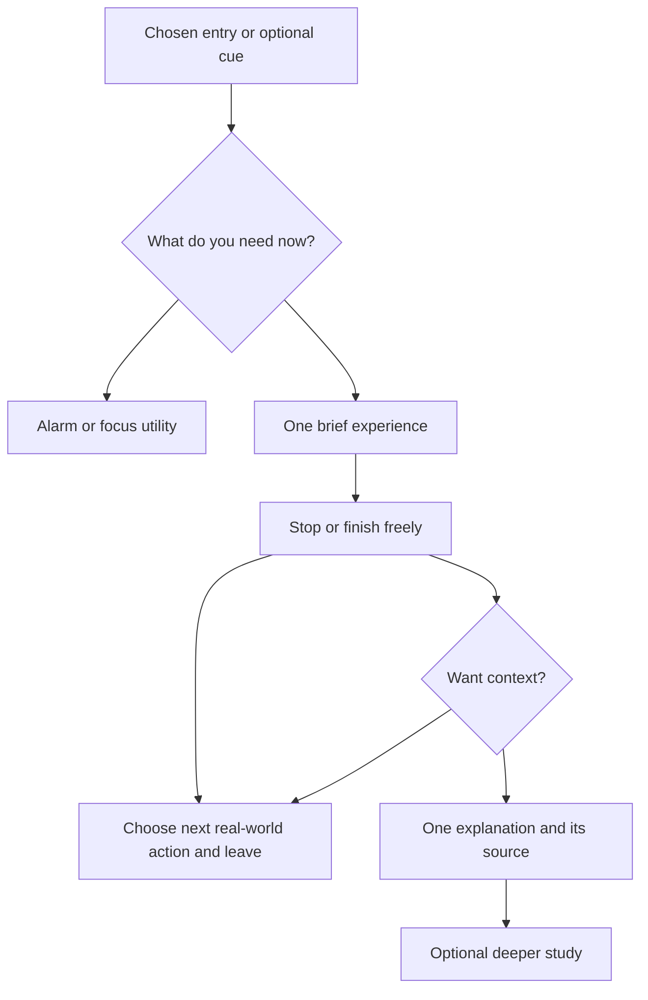

# Depth with low cognitive friction

29 September 2026. **PROPOSED research synthesis and experiments.** No application navigation or copy is changed by this document.

## Evidence before slogans

Progressive disclosure exposes optional complexity on request; staged disclosure divides a necessary task into sequential steps. They solve different problems. A sequence of many easy screens can still be a burdensome intake. **Design inference:** count total decisions, reversals and setup time, not just controls per screen. [Nielsen's original explanation](https://www.nngroup.com/articles/progressive-disclosure/).

Recognition-oriented controls make choices and context visible rather than demanding recall of instructions. **Inference for Shanivar:** show the chosen activity on a block screen and make the existing plan editable instead of asking the person to reconstruct it. This is a design heuristic, not a claim that a given screen will improve meditation. [NN/g usability heuristics](https://www.nngroup.com/articles/ten-usability-heuristics/).

W3C cognitive-accessibility guidance emphasizes understandable words, structure and purpose. **Inference:** spiritual depth must not be encoded in ambiguous operational verbs. “End practice” is clearer than “Release into being.” This supplemental guidance is not an accessibility certification of our native app. [W3C clear-content objective](https://www.w3.org/WAI/WCAG2/supplemental/objectives/o3-clear-content/).

The cross-product research is in [COMPETITOR_PRODUCT_RESEARCH.md](COMPETITOR_PRODUCT_RESEARCH.md); empirical cognitive/behavioral mechanisms and limits are in [MODERN_PSYCHOLOGY_BRIDGE.md](MODERN_PSYCHOLOGY_BRIDGE.md). Do not turn a product's popularity into proof of why its pattern works.

## A proposed interaction grammar

One meaningful decision per screen is a default, not a command to inflate the number of screens. A proposed first voluntary practice has three substantive choices: **try or decline; accept or change the anchor; leave or explore after it ends.** Safety/context and explicit comfort remain necessary where the selected practice requires them. A no-breath external exercise avoids collecting breath preferences for no reason. The actual number of taps must be measured in the tested prototype.

Keep known utilities visible. Someone setting an alarm should not be diverted into a philosophy conversation. Active alarm and focus status take precedence over a suggested practice. The deep journey is an optional path through ordinary experience, not a replacement for utility navigation.

This diagram is a proposed architecture, not a new tab bar. NOTICE → UNDERSTAND → EXPERIENCE → OBSERVE → INTEGRATE is a teaching purpose; those five words need not become five screens. Understanding can be a few ordinary words, and integration can occur away from the phone.

## Pattern library

| Pattern | Shanivar-specific proposal | Risk / test |
| --- | --- | --- |
| Experience before explanation | Offer one ordinary sensation, with visible source access when applicable | Some people need context before consent; keep “Why this?” available before Start |
| Progressive depth | Instruction → short reason → adaptation/source → edition/disagreement | Never hide material risks or restrictions behind source details |
| Contextual permissions | Ask for alarm or blocking capability only within that chosen utility | Avoid a global permission gauntlet; test honest denied-permission recovery |
| Stable action placement | End in a stable player bar; host-aware return | Decorative simplicity cannot hide stopping or override |
| Familiarity before novelty | Offer “Repeat my last choice” without assuming it helped | Felt-worse/unknown results must not reinforce a recommendation |
| Explicit customization | Let people correct feeling, time and preferred anchor | No inferred mental state from birth data, clock or engagement |
| Bounded reflection | One optional observation; no endlessly generated follow-up | Review may restart rumination; accept “Nothing to add” |
| Habit through a chosen context | Attach a brief action to a user-named routine | No app-generated universal “best time”; missed practice is not failure |
| Ritual without status | Reuse an opening/closing action if the person values it | Ceremony can become friction or compulsion; optional and reversible |
| Interruption with permission | Optional cue at a chosen boundary, not every scroll or unlock | Measure nuisance and disabled cues, not only successful interruptions |
| Finite recommendations | One eligible proposal plus Change, not an infinite practice feed | Compare against direct repeat; personalized choice may be worse than familiarity |
| Return without dependency | Optional taper in prompts; easy return whenever wanted | Falling opens alone cannot demonstrate independent capacity |

## Current Steady friction audit

Source inspected: [wireframe](../../android-app/wireframes/steady/README.md), `android-app/wireframes/steady/app.js`, and current native `BreathingScreen.kt` existence/release record. This is a design review, not a new device test.

The wireframe's first selection screen asks for feeling, duration and context; the next asks for breath, sound, prior comfort and possibly sleepiness. The suggested list and safety confirmation follow. That can protect explicit consent, but it conflicts with the new desire for an almost effortless first experience if every choice is mandatory in practice. Do not remove gates blindly. **Proposed experiment:** a short external-anchor entry with no breath or schedule intake versus the existing chooser; keep the full chooser available to those who want it. Observe who cannot find what they need and who mistakenly expects treatment.

The name Steady and static attention marker can remain. The new research does not authorize breath-pacing animation, a guru chat persona, a mood-detection model or a library of increasingly intense practices. Source access is useful; repeated source-reading should not be mistaken for practice transfer.

## Original proposed microcopy

| Moment | Copy | Why it fits Shanivar |
| --- | --- | --- |
| Automatic reach | “You opened your phone. What were you about to do?” | Specific observation, no claim to know motive |
| Optional experience | “Notice one ordinary detail around you for a moment.” | Direct, accessible alternative to inward attention |
| Beginning breath attention | “Let the breath keep its own pace.” | No hidden performance target |
| Reflection | “Did anything change? Nothing changed is an answer too.” | Observation rather than positive-result pressure |
| Disagreement | “Leave this interpretation aside.” | Epistemic agency made operational |
| Deeper context | “See the source and what we adapted.” | Fidelity without jargon-first onboarding |
| Return | “What would you like to do next?” | Hands the decision back |
| Focus boundary | “You chose this time for reading.” | Uses chosen context, not punishment |

These are proposals, not reviewed practice scripts or changes to shipped strings. Avoid metaphysical claims such as “You are not your thoughts” as an app verdict. If an inquiry about thoughts is offered, keep it bounded, optional and open to multiple interpretations.

## Notification and recommender rules to test

Start with user-chosen context and the existing deterministic eligibility rules. No notification is needed for an on-demand exercise. If a routine cue is requested, show its schedule and what it does, offer quiet periods and a single obvious off switch. Repeated dismissal should reduce prompts, not intensify emotional copy. Exact thresholds need validation; no learned psychological profile is required.

Record recommendation reasons as inputs (“You chose one minute”) rather than claimed internal states (“Your nervous system needs this”). Do not use age, belief, streaks or engagement to infer readiness for advanced practice. Manual corrections outrank recommendations. No experimental change to alarm safety or app-lock release is permitted to improve engagement.

## Research-to-product experiment cards

**UX-01 — Minimum useful entry.** Sources: progressive-disclosure heuristic, current chooser inspection, founder brief. Confidence: high that the current chooser has multiple choices; low that fewer choices improve this audience's experience. Principle: remove irrelevant setup before an ordinary action. Product implication: optional direct external-anchor entry. Experiment: within-participant counterbalanced usability tasks, eight consenting adults, current chooser vs brief entry, identical visual quality. Success: at least six can begin and end without help and accurately explain what occurred; fewer help requests than current flow. Failure: hidden safety/choice, confusion, distress or poor suitability. Decision: TEST; thresholds are proposed usability gates, not statistical efficacy proof.

**UX-02 — Depth on request.** Sources: tradition provenance requirements + progressive disclosure. Confidence: moderate for design principle, low for Shanivar effect. Product implication: short source label with optional detail. Experiment: same practice, concise label vs expanded upfront explanation. Success: source/adaptation comprehension without higher abandonment; failure: people miss important context or feel misled. Decision: TEST.

**UX-03 — Return without reward pressure.** Sources: founder independence stance + product patterns, empirical support delegated to psychology bridge. Product implication: optional repeat and chosen cue, no streak loss. Experiment: seven-day diary of voluntary returns and self-chosen offline use; ask why people stopped. Success: understandable usefulness and voluntary transfer; failure: dependence, guilt, nuisance, or unknown departure mislabeled as success. Decision: TEST.

**UX-04 — Accessibility and interruption.** Sources: W3C guidance + current native release gaps. Confidence: high that those gates remain unverified. Product implication: scalable text, named controls, no mandatory animation, stable End. Experiment: physical-device TalkBack, large-text and interruption tasks, including motor alternatives. Success: all safety exits reachable; failure: any trapped or ambiguous state. Decision: HOLD public claims until verified.
