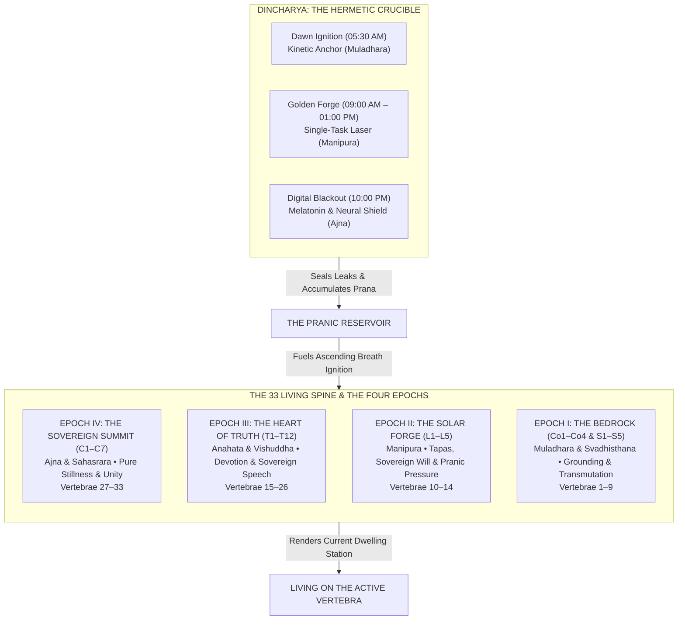

# THE 33 LIVING SPINE: The Sacred Spiritual and Biophysical Architecture of Kriya Sadhana for Shanivar

> **Author:** Kriya Yoga Master & Spiritual Scientist, Shanivar  
> **Audience:** Steve Jobs Product Design Agent, Engineering Leads, & The Founder  
> **Status:** Canonical Phase 3 Architecture Blueprint (Approved for UI/UX & Engine Implementation)  
> **Cross-Reference:** Decisions 0009, 0013, 0014, 0017, 0019; PRD §3.2; `PRACTICE_SAFETY.md`

---

## EXECUTIVE PROLOGUE: THE CEREBROSPINAL ENGINE

Modern productivity apps treat human beings like mechanical software daemons: input a task, receive a notification, check a box, maintain a streak. This reduces the human nervous system to a Pavlovian loop, exacerbating the very neurochemical fragmentation (the "Drift") it claims to cure.

Shanivar rejects this premise. 

The human body is an electro-magnetic dynamo; the **cerebrospinal axis (the 33 vertebrae of the living spine)** is its central highway of consciousness. As taught through the immortal lineage of Mahavatar Babaji, Lahiri Mahasaya, Swami Sri Yukteswar, and Paramahansa Yogananda, and mirrored in Patanjali’s *Yoga Sutras*, the *Shiva Samhita*, and the *Vijnana Bhairava Tantra*:

> *“The spine and the brain are the altars of God. That is where the subtle electrical currents of life descend into matter, and that is where they must be guided back to cosmic consciousness.”*  
> — **Paramahansa Yogananda**, *God Talks With Arjuna*

In the unawakened human, Prana (life force) continuously leaks downward and outward through the sensory avenues—a bio-energetic entropy known as **The Drift**. Kriya Sadhana reverses this direction. By uniting the breath (*Prana* and *Apana*) within the subtle central canal (*Sushumna Nadi*), life force is magnetized upward through the 33 vertebrae.

This document establishes the authoritative architecture for **Phase 3: Sadhana (The 33 Living Spine)**. It delivers the sacred, anatomical, bio-energetic, and tactile specifications required to make the spine the living, breathing, trackable engine of Shanivar.

---



---

# SECTION 1: THE SACRED ARCHITECTURE OF THE 33 LIVING SPINE

The human spine is not an inert calcium scaffolding; it is a **living piezoelectric resonator**, an organic antenna connecting the physical earth (*Prithvi*) to unconditioned cosmic consciousness (*Brahman*).

The 33 vertebrae correspond to 33 distinct stages of energetic consolidation across five spinal segments, sheltering the **Sushumna Nadi** (the cerebrospinal central canal) and flanked by the dual polar currents of **Ida** (lunar, cool, parasympathetic) and **Pingala** (solar, warm, sympathetic).

```
                      SAHASRARA / BROW (C1 - C7)
                          [Vertebrae 27 - 33]
                                   │
                                   ▲ Inhale: Cool Sushumna Current
                                   │ (Ascending Evolution)
                     THROAT & HEART (T1 - T12)
                          [Vertebrae 15 - 26]
                                   │
                                   │
                      SOLAR FORGE / NAVEL (L1 - L5)
                          [Vertebrae 10 - 14]
                                   │
                                   │ Exhale: Warm Purifying Current
                                   ▼ (Descending Grounding)
                    SACRUM & COCCYX (S1 - S5, Co1 - Co4)
                           [Vertebrae 1 - 9]
```

### 1.1 The Vertebral-Chakra Mapping Matrix

| Spinal Section | Vertebrae | Chakra / Center | Element | Vayu | Pranic Function & Neurological Substrate |
|---|---|---|---|---|---|
| **Coccygeal** | **Co1 – Co4** (Vertebrae 1–4) | **Muladhara** (Base Center) | Prithvi (Earth) | *Apana Vayu* | **The Anchor of Being.** Pelvic floor innervation (pudendal nerve, coccygeal plexus). Biological survival, somatic grounding, skeletal integrity, elimination of toxic inertia. Pierces the threshold of **Brahma Granthi**. |
| **Sacral** | **S1 – S5** (Vertebrae 5–9) | **Svadhisthana** (Fluid Sacrum) | Apas (Water) | *Apana / Vyana* | **Emotional Transmutation & Vital Current.** Pelvic splanchnic nerves, prostatic/uterine plexus. Creative energy, sexual fluid conservation (*Ojas* production), transmuting reactive emotional cravings into deep emotional steadiness. |
| **Lumbar** | **L1 – L5** (Vertebrae 10–14) | **Manipura** (Solar Forge) | Tejas (Fire) | *Samana Vayu* | **Willpower, Metabolic Heat & Sovereign Execution.** Celiac/solar plexus, adrenal medulla. Digestion of physical matter and cognitive inputs. The engine of *Tapas* (austere self-discipline). Converts scattered desires into laser-focused intent. |
| **Lower/Mid Thoracic** | **T7 – T12** (Vertebrae 15–20) | **Anahata** (Heart Lotus) | Vayu (Air) | *Prana Vayu* | **Compassionate Equanimity & Cosmic Resonance.** Cardiac plexus, sympathetic chain ganglia, vagal cardiac branches. Transmuting attachment and fear into unbroken non-reactive empathy. Pierces **Vishnu Granthi** (the knot of emotional bondage). |
| **Upper Thoracic / Cervico-Thoracic** | **T1 – T6** (Vertebrae 21–26) | **Vishuddha** (Throat / Sovereign Truth) | Akasha (Ether/Space) | *Udana Vayu* | **Sovereign Expression & Cognitive Stillness.** Pharyngeal plexus, recurrent laryngeal nerve. Silence of speech, speaking only essential truth, non-judgment, dissolution of dualistic likes and dislikes. |
| **Cervical / Sub-Occipital** | **C1 – C7** (Vertebrae 27–33) | **Ajna / Medulla / Sahasrara** (Spiritual Eye & Crown) | Manas / Mahat (Pure Light & Space) | *Vyana / Udana* | **Intuition, Breathlessness & Unitary Consciousness.** Medulla oblongata (the "Mouth of God"), pineal gland, optic chiasm (Kutastha / Ajna), and the cerebral cortex (Sahasrara). Pierces **Rudra Granthi** (the knot of individual ego identification). |

---

### 1.2 The Biophysical Science: Reversing "The Drift"

Why does ascending the spine constitute evolutionary acceleration?

1. **The Downward Entropy of The Drift (Apana Cascade):**  
   In the ordinary individual, attention is continuously pulled outward through the senses. Every flash of blue light, algorithmic ping, or reactive emotion stimulates the sympathetic nervous system and triggers an unconscious downward discharge of Prana through the senses, reproductive organs, and lower nerve centers. The breath becomes shallow, fast, and chest-bound (15–20 breaths/min), feeding continuous cortical alarm and amygdala overdrive.

2. **The Upward Reversal of Kriya Pranayama (Prana-Apana Integration):**  
   *Patanjali’s Yoga Sutra* 2.49 defines Pranayama as:  
   *“Tasmin sati shvasa-prashvasayor gati-vichchhedah pranayamah”*  
   (Pranayama is the cessation of the uninterrupted movements of inhalation and exhalation).  
   
   By intentionally guiding the mental focus and breath through the Sushumna:
   - **Inhalation** lifts the life currents from the coccyx upward to the medulla and brain, bathing the spine in a cool, calming current that quietens sensory reactivity.
   - **Exhalation** flows back down the spinal axis as a soothing warm current, incinerating physical tension and grounding the nervous system without losing mental alert presence.
   - **Neurological Deceleration:** Breathing slows from 16 breaths/min down to 4–6 breaths/min (0.08–0.1 Hz), activating the cardiac baroreflex, inducing maximal Heart-Rate Variability (HRV) coherence, and stimulating the ventral vagal complex of Cranial Nerve X (the Vagus Nerve).
   - **Piezoelectric Charge:** The cerebrospinal fluid (CSF) pulses rhythmically through the foramen magnum and spinal cord. Axial elongation during conscious spinal breathing creates a micro-piezoelectric voltage across the bone matrices of the 33 vertebrae, magnetizing the spine and drawing Prana away from the sensory nerves into the spiritual axis.

---

# SECTION 2: WHAT IT MEANS TO "LIVE ON EACH SECTION OF THE SPINE"

In Shanivar, **the practitioner does not play a video game; they inhabit an energetic altitude.**

Ascension from Vertebra 1 to Vertebra 33 is not a casual UI progression; it is the progressive neurological, emotional, and cognitive stabilization of the practitioner’s living state. A user does not "visit" a vertebra for five minutes and jump ahead. They **dwell** on it until its spiritual quality becomes their baseline psychological default.

```
       [ C1–C7 ]  VERTEBRAE 27–33: THE SOVEREIGN SUMMIT
       • Mind: Intuitive stillness, zero mental chatter, direct perception
       • Daily Life: Sovereign composure under catastrophe, unshakeable peace
       • Neurological State: High gamma/theta coherence, natural breathlessness

       [ T1–T12 ] VERTEBRAE 15–26: THE HEART OF TRUTH
       • Mind: Non-reactive witnessing, speech sovereignty, emotional neutrality
       • Daily Life: Empathy without codependency, absolute truth in speech
       • Neurological State: 0.1 Hz HRV cardiac resonance, vagal brake engaged

       [ L1–L5 ]  VERTEBRAE 10–14: THE SOLAR FORGE
       • Mind: Laser focus, elimination of hesitation, fierce willpower
       • Daily Life: 4-hour uninterrupted deep work, zero procrastination
       • Neurological State: Steady dopamine baselines, autonomic resilience

       [ Co1–S5 ] VERTEBRAE 1–9: THE BEDROCK
       • Mind: Somatic grounding, eradication of existential dread
       • Daily Life: Consistent morning rising, feet on the floor, zero snooze
       • Neurological State: Sympathetic calming, pelvic parasympathetic tone
```

### 2.1 The Four Epochs of Lived Dwelling

#### Epoch I: The Bedrock (Vertebrae 1–9: Co1–Co4 & S1–S5)
* **The Lived Experience:** Grounded, unhurried, heavy in the pelvis, solid like basalt stone.
* **The Psychological Signature:** Overcoming survival panic, doomscrolling evasion, and emotional mood swings. The practitioner stops feeling like a fragile ghost floating above a desk.
* **Daily Expression:** Waking up at Dawn Ignition on the first alarm. Feet hit the earth immediately. No reaching for the phone in bed. Meals eaten sitting down with sensory presence.
* **The Warning Signal of Slipping:** Restless legs, opening Instagram while waiting for an elevator, financial anxiety, sleep paralysis.

#### Epoch II: The Solar Forge (Vertebrae 10–14: L1–L5)
* **The Lived Experience:** Internal heat, radiant gut center, crisp execution, zero friction between intention and action.
* **The Psychological Signature:** Overcoming procrastination, resistance, and victim mindset. The practitioner embraces hard work not as a corporate chore, but as *Tapas* (sacred purifying fire).
* **Daily Expression:** Entering the Golden Forge (09:00 AM – 01:00 PM) without hesitation. Closing 40 open browser tabs. Sustaining single-task concentration for 90-minute blocks without fidgeting.
* **The Warning Signal of Slipping:** Midday sugar cravings, compulsive slack-checking, starting tasks and leaving them 80% done, irritation with colleagues.

#### Epoch III: The Heart of Truth (Vertebrae 15–26: T1–T12)
* **The Lived Experience:** Spacious chest, cool throat, expansive awareness, quiet tongue.
* **The Psychological Signature:** The cessation of emotional defense mechanisms. The practitioner ceases gossiping, complaining, boasting, or seeking external validation.
* **Daily Expression:** Speaking only when speech improves upon silence. Listening deeply without formulating a counter-argument. Working with devotion without attaching self-worth to outcomes.
* **The Warning Signal of Slipping:** Engaging in internet arguments, speaking cynically, passive-aggressive communication, tightness across the upper chest.

#### Epoch IV: The Sovereign Summit (Vertebrae 27–33: C1–C7)
* **The Lived Experience:** Crystalline brow, cool sensations at the medulla oblongata, spontaneous lengthening of breathless pauses, unbroken witnessing awareness.
* **The Psychological Signature:** Complete freedom from ego-identified drama. The practitioner perceives reality directly, unmediated by anxiety or projection.
* **Daily Expression:** Walking through modern cities without sensory overwhelm. Deep, restorative sleep during Digital Blackout. Complete sovereignty over one’s attention.
* **The Warning Signal of Slipping:** Subtle intellectual arrogance, spiritual bypassing, neglecting physical health or grounding.

---

### 2.2 App Representation of the "Home Station"

The user’s current spinal station is **not a trophy icon**. It is an environmental presence in the Shanivar interface:
1. **The Subtle Luminescence of the Active Segment:**  
   In the Living Spine visualization, the active vertebra is illuminated with an organic, pulsating bronze/amber core. All vertebrae below it glow with settled, steady warmth (grounded foundation). All vertebrae above it remain in quiet obsidian outline (the territory yet to be claimed).
2. **The Station Altitude Indicator:**  
   When the user opens the Sadhana tab, there is no generic greeting. The interface displays the current active station:
   > `ACTIVE DWELLING: VERTEBRA 11 • LUMBAR L3 (MANIPURA FORGE)`  
   > `STABILIZATION: DAY 6 OF 14 • THE VESSEL HOLDS`
3. **Localized Sensory Anchoring:**  
   When the user holds the phone or rests it on their body, the haptic engine emits a localized micro-thrum calibrated specifically to the resonant frequency of that active station.

---

# SECTION 3: THE SYMBIOSIS: HOW ROUTINE (DINCHARYA) FEEDS SADHANA ASCENSION

The greatest failure of contemporary spiritual seekers is attempting intense meditation while living chaotic, undisciplined daily lives. 

**Routine without Sadhana is dry corporate mechanics.**  
**Sadhana without Routine is ungrounded delusion.**

In Kriya science, **Dincharya is the Hermetic Vessel**; **Sadhana is the Sacred Flame**. If your vessel has holes—leaking Prana through midnight scrolling, fractured multitasking, and erratic sleep—pouring Kriya Pranayama into your spine is like pumping high-octane rocket fuel into a shattered cylinder. The energy dissipates into anxiety, restlessness, and spiritual pride.

```
       ┌─────────────────────────────────────────────────────────────┐
       │                   THE PRANIC RESERVOIR                      │
       ├─────────────────────────────────────────────────────────────┤
       │  INPUTS (Prana Preserved via Dincharya):                    │
       │  + Dawn Ignition: Reclaims morning circadian daylight (+2h) │
       │  + Golden Forge: Prevents attention fragmentation (+4h)     │
       │  + Digital Blackout: Protects melatonin & deep sleep (+3h)  │
       │                                                             │
       │  LEAKS (Prana Surrendered to The Drift):                    │
       │  - Midnight Doomscroll: Autonomic exhaustion (-3.3h)        │
       │  - Morning Paralysis / Snooze: Splanchnic inertia (-2.8h)   │
       │  - Shallow Multitasking: Cortisol / dopamine churn (-4.0h)  │
       │                                                             │
       │  =========================================================  │
       │  PRANIC VOLTAGE AVAILABLE FOR SPINAL ASCENSION:             │
       │  [ V_prana = Routine Stability Factor × Sadhana Cycles ]   │
       └─────────────────────────────────────────────────────────────┘
```

### 3.1 The Bio-Energetic Mechanism of the Three Iron Anchors

1. **Anchor 1: Dawn Ignition (`05:30 AM` — Muladhara / Co1–Co4):**  
   - *Physical Mechanism:* The 20-step accelerometer-verified walk forces the practitioner out of bed, immediately stimulating foot proprioceptors and plantar fascia, signaling the suprachiasmatic nucleus (SCN) that day has begun.
   - *Energetic Consequence:* Clears the night’s residual Tamas (inert stagnation). Grounds the life force at Muladhara, creating the solid pelvic bedrock without which higher spinal currents cannot rise safely.

2. **Anchor 2: The Golden Forge (`09:00 AM – 01:00 PM` — Manipura / L1–L5):**  
   - *Physical Mechanism:* 4 hours of impenetrable deep work shield. Phone lock blocks dopamine-seeking context switching.
   - *Energetic Consequence:* Gathers the scattered mental rays into a single solar beam (*Samana Vayu*). Prevents the catastrophic autonomic depletion caused by micro-interruptions (which burn up to 40% of daily glucose and neural energy). Stores this conserved life force in the solar plexus as a dense reservoir.

3. **Anchor 3: Digital Blackout (`10:00 PM` — Ajna / C1–C7):**  
   - *Physical Mechanism:* Screen glass goes dark. Blue light is extinguished 90 minutes before sleep.
   - *Energetic Consequence:* Prevents the suppression of pineal melatonin synthesis. Allows the cerebrospinal fluid (CSF) glymphatic wash to clear neurotoxic waste from the cerebral cortex. Protects the delicate spiritual circuitry of Ajna and Sahasrara from electronic bombardment.

### 3.2 The Pranic Reservoir Formula

To maintain strict scientific honesty and prevent mystical hand-waving, Shanivar defines the **Pranic Reservoir Score ($P_R$)** as an auditable mathematical relationship:

$$P_R = \left( \frac{\text{Successful Iron Anchors Completed}}{\text{Total Iron Anchors Scheduled}} \right)_{\text{Rolling 7 Days}} \times \left( \frac{\text{Completed Kriya Spinal Cycles}}{\text{Target Cycles}} \right)$$

* **If $P_R < 0.70$:** The vessel is leaking. The user lacks the pranic pressure necessary to stabilize higher spinal centers. Ascension is paused. The app gently advises: *"Seal the vessel at the base. Tend your anchors before seeking the heights."*
* **If $P_R \ge 0.85$ for the full stabilization window:** The reservoir is full. The active vertebra awakens, and the practitioner earns the right to take the test of ascension to the next vertebra.

---

# SECTION 4: THE SADHANA ACTION: KRIYA SPINAL BREATHING & MICRO-FREQUENCY HAPTICS

The core Sadhana practice inside Shanivar is **Kriya Spinal Pranayama (Sushumna Sanchara)**. It is performed in a clean, upright seated posture.

### 4.1 The Breath Mechanics (The Four-Phase Cadence)

```
        ANTARA KUMBHAKA (Holding at Active Vertebra)
        [ Illumination • Piercing Samskaras • Resonant Hold ]
                     ┌───────────────┐
                     │   3 - 6 sec   │
                     └───────┬───────┘
                             ▲
                             │
     INHALE (Cool Sushumna)  │  EXHALE (Warm Purifying)
     [ Coccyx to Station ]   │  [ Station to Coccyx ]
     6 - 12 seconds          │  6 - 12 seconds
                             │
                             ▼
                     ┌───────────────┐
                     │   3 - 6 sec   │
                     └───────────────┘
        BAHYA KUMBHAKA (Post-Exhale Void / Stillness)
        [ Pure Silence • Kevala Kumbhaka Seed ]
```

1. **Phase 1: Inhalation (Puraka) — The Cool Upward Current (6 to 12 Seconds):**  
   - *Action:* Slow, deep, silent diaphragmatic inhalation through the nose with a gentle micro-contraction of the glottis (subtle Ujjayi).  
   - *Visualization:* Mentally feel and visualize a fine, luminescent thread of cool, bluish-white electric liquid light ascending straight up through the center of the spine (Sushumna) from the coccyx (Co1) up through each vertebra until it reaches the **Active Dwelling Vertebra**.  
   - *Subtle Sound:* Internalized mental mantra or resonance: *“SO”* or silent cool rushing current.

2. **Phase 2: Inhale Retention (Antara Kumbhaka) — Illumination at the Station (3 to 6 Seconds):**  
   - *Action:* The breath is held effortlessly without straining the throat or chest. The chin stays level; the shoulders stay relaxed.  
   - *Focus:* Consciousness is pinned like an intense laser at the **Active Dwelling Vertebra**. Feel that specific bone and nerve plexus vibrating with condensed solar energy, burning through latent karmic impressions (*samskaras*).  
   - *Quality:* Total crystalline stillness. No panic. No air hunger.

3. **Phase 3: Exhalation (Rechaka) — The Warm Downward Current (6 to 12 Seconds):**  
   - *Action:* Slow, smooth, effortless exhalation through the nose.  
   - *Visualization:* Feel a soothing, golden-amber warm current flowing down from the Active Vertebra through the spine, washing away all residual metabolic toxins, emotional friction, and nervous tension, grounding them deep into the bedrock of the coccyx and earth.  
   - *Subtle Sound:* Internalized mental mantra: *“HUM”* or warm descending wave.

4. **Phase 4: Post-Exhale Pause (Bahya Kumbhaka) — The Void of Dissolution (3 to 6 Seconds):**  
   - *Action:* The lungs rest empty. The diaphragm remains softly relaxed.  
   - *Focus:* Rest in the absolute, thought-free stillness at the base of the spine. This is the seed of *Kevala Kumbhaka* (natural, spontaneous breathlessness), where the mind discovers it does not need breath to exist.

---

### 4.2 Sensory Haptic Profile: The Phone as an Energetic Tuning Fork

One of the greatest hazards of digital meditation apps is that they force the user to stare at a bright glowing glass screen, keeping visual attention externalized.

**Shanivar solves this with Eyes-Closed Micro-Frequency Haptics.**

The user holds the phone flat against their sternum/solar plexus with both hands, or rests it gently in their lap touching their palms. The device's precision linear resonant actuator (LRA) acts as a physical proprioceptive guide, transmitting the exact cadence of the spinal breath directly into the somatic nervous system without a single glance at the screen.

```
HAPTIC PROFILE WAVEFORM ACROSS A SINGLE KRIYA BREATH CYCLE:

Intensity
  ▲
  │                     [ANTARA KUMBHAKA]
  │                     Resonant 0.5Hz Pulse
  │                     ████████████████
  │                    ▲                ▼
  │                   ╱                  ╲
  │                  ╱                    ╲
  │  [INHALE]       ╱                      ╲   [EXHALE]
  │  Ascending     ╱                        ╲  Descending
  │  Micro-Tick   ╱                          ╲ Micro-Tap
  │  Ramp        ╱                            ╲ Cascade
  │  (60→180Hz) ╱                              ╲ (180→60Hz)
  │            ╱                                ╲
  │  ─────────┴──────────────────────────────────┴─────────────
  │                                               [BAHYA]
  │                                               PURE SILENCE
  └─────────────────────────────────────────────────────────────► Time
     0s       Inhale (8s)        Hold (4s)     Exhale (8s)  Pause (4s)
```

#### Detailed Haptic Envelope Specifications

1. **Inhale Sweep (Ascending Micro-Tick Ramp):**  
   - *Pattern:* A sequence of crisp, ultra-precise micro-ticks whose spacing progressively compresses and whose frequency sweeps upward from **60 Hz** (deep subtle thud) to **180 Hz** (crisp electrical tick).
   - *Sensation:* It feels physically as if an elevator of subtle electrical fluid is rising up the center of the torso.
   - *Tick Spacing:* Starts at 400 ms apart, accelerating exponentially to 100 ms apart as the breath reaches the target vertebra.

2. **Antara Kumbhaka (Station Resonance Hold):**  
   - *Pattern:* The ticking ceases. The actuator emits a slow, warm, coherent harmonic pulse at **0.5 Hz** (one slow swelling pulse every 2 seconds, mimicking the resting CSF pulse).
   - *Sensation:* A deep, grounding heartbeat-like hum resting precisely in the center of the chest/abdomen. It holds the practitioner’s wandering mind pinned to the active vertebra without agitation.

3. **Exhale Waterfall (Descending Micro-Tap Cascade):**  
   - *Pattern:* The frequency drops from **180 Hz down to 60 Hz**. The micro-taps become broader, softer, and more spaced out (from 100 ms decelerating to 500 ms).
   - *Sensation:* A warm, settling wave washing down the torso into the seat. The shoulders drop; the jaw unhinges; the nervous system sinks into deep parasympathetic ventral vagal dominance.

4. **Bahya Kumbhaka (The Mechanical Void):**  
   - *Pattern:* **Absolute Zero.** Not a single vibration. Not a tick. Pure mechanical, electrical, and tactile silence.
   - *Sensation:* Complete stillness. The absence of tactile feedback mirrors the absence of breath and the absence of thought.

---

# SECTION 5: PROGRESSIVE ROADMAP & ASCENSION CRITERIA

Shanivar completely rejects superficial gamification—streaks, XP, badges, leveling up by button-mashing, or social leaderboards. Spiritual ascension is an organic neuro-somatic reality; faking it damages the nervous system.

Ascending from Vertebra 1 (Coccyx) to Vertebra 33 (Crown) requires passing through four distinct evolutionary epochs.

```
                                  [ VERTEBRA 33: SAHASRARA ]
                                              │
                      ┌───────────────────────┴───────────────────────┐
                      │    EPOCH IV: THE SOVEREIGN SUMMIT (C1–C7)     │
                      │    Vertebrae 27–33 • 28 Days Minimum / Station│
                      │    Kevala Kumbhaka • Intuitive Direct Seeing  │
                      └───────────────────────┬───────────────────────┘
                                              │
                      ┌───────────────────────┴───────────────────────┐
                      │    EPOCH III: THE HEART OF TRUTH (T1–T12)     │
                      │    Vertebrae 15–26 • 21 Days Minimum / Station│
                      │    Vishnu Granthi Pierced • Speech Sovereignty│
                      └───────────────────────┬───────────────────────┘
                                              │
                      ┌───────────────────────┴───────────────────────┐
                      │    EPOCH II: THE SOLAR FORGE (L1–L5)          │
                      │    Vertebrae 10–14 • 14 Days Minimum / Station│
                      │    Tapas • Adrenal Mastery • Deep Work Armor  │
                      └───────────────────────┬───────────────────────┘
                                              │
                      ┌───────────────────────┴───────────────────────┐
                      │    EPOCH I: THE BEDROCK (Co1–Co4 & S1–S5)     │
                      │    Vertebrae 1–9 • 7 Days Minimum / Station   │
                      │    Brahma Granthi Base • Feet on Earth        │
                      └───────────────────────────────────────────────┘
```

### 5.1 The Four Epochs & Dwelling Protocols

| Epoch | Vertebral Span | Anatomical Region | Minimum Dwelling Period | Core Neurological Mastery |
|---|---|---|---|---|
| **Epoch I: The Bedrock** | **V1 – V9** (Co1–Co4, S1–S5) | Coccyx & Sacrum | **7 Days per Vertebra** (63 days total) | Eradication of circadian inertia, establishment of Dawn Ignition, stabilization of pelvic parasympathetic tone. |
| **Epoch II: The Solar Forge** | **V10 – V14** (L1–L5) | Lumbar & Solar Plexus | **14 Days per Vertebra** (70 days total) | Mastery of prolonged deep work focus, transmutation of emotional reactivity into willpower, digestive fire balance. |
| **Epoch III: The Heart of Truth** | **V15 – V26** (T1–T12) | Thoracic (Heart & Throat) | **21 Days per Vertebra** (252 days total) | Unbroken non-reactive witnessing, speech sovereignty (elimination of gossip, lying, boasting), heart HRV coherence. |
| **Epoch IV: The Sovereign Summit** | **V27 – V33** (C1–C7) | Cervical, Medulla & Crown | **28 Days per Vertebra** (196 days total) | Spontaneous breathlessness (*Kevala Kumbhaka*), ajna illumination, single-pointed intuitive guidance, unity consciousness. |

*Total Path Duration:* ~581 days (~1.6 years) of disciplined, unhurried, monumental transformation. This is not a 30-day challenge; it is a life foundation.

---

### 5.2 The Honest, Anti-Cheat Ascension Criteria

To step from Vertebra $N$ to Vertebra $N+1$, the practitioner must fulfill **The Threefold Gate of Ascension**:

1. **Gate 1: The Soil Test (Temporal Consolidation):**  
   - The user must dwell at the current vertebra for the **minimum mandatory dwelling days** for that epoch (7, 14, 21, or 28 days).  
   - No amount of extra meditation minutes or app usage can accelerate this clock. The physical myelination of nerve pathways requires biological time.

2. **Gate 2: The Vessel Test (Dincharya Integrity):**  
   - Across the dwelling window, the user must maintain a **$\ge 85\%$ compliance rate with the Three Sacred Iron Anchors** (Dawn Ignition, Golden Forge, Digital Blackout).  
   - If the user had more than 2 major anchor breaches in the preceding 7 days (e.g., late-night screen use after 11 PM or missed Dawn Ignition), the vessel is classified as *Fractured*. The gate remains closed until 7 consecutive days of sealed discipline are logged.

3. **Gate 3: The Flame Test (Sadhana Breath Stability):**  
   - The user must complete the daily Kriya Spinal Breathing session at their target duration (default: 3 to 10 minutes) without premature exit, pause, or app switching.  
   - The session must conclude with an unhurried, steady post-exhale pause, confirmed by the user’s self-check of **"Steady"** or **"Grounded"**.

When all three gates are open, the app illuminates the **Ascension Rite**: a focused 5-minute transition meditation where the practitioner consciously draws the energy from the old vertebra and anchors it firmly into the new station above.

---

### 5.3 The Honest Mirror: Handling Lapses Without Guilt

In commercial apps, if you miss a streak, you are punished with a broken flame icon, lost badges, or shame-inducing notifications (*"Oh no! You lost your 14-day streak!"*). This triggers shame avoidance, causing the user to delete the app.

In Kriya science, **the spine is an honest mirror of physics.** If you stop exercising, your muscles do not disappear in a day, but their tone softens. Similarly, if your Dincharya lapses, the energy does not vanish; it simply settles back to the last fully stabilized foundation.

#### The Luster & Anchor Fallback Model
- **The Anchor Vertebra:** When a practitioner successfully completes an entire Epoch (e.g., all 9 vertebrae of Epoch I), that base becomes their permanent **Anchor Station**. They can never fall below it.
- **Luster Dimming (Mild Drift):** If a user misses 2–3 days of Dincharya or Sadhana, their active vertebra does not reset. Instead, its visual glow in the app shifts from **Radiant Gold** to a **Soft Smoldering Amber**.  
  - *Tone of the App:*  
    > *“The fire burns low when untended. No shame. No hurry. Light the dawn tomorrow; the spine is patient.”*
- **Station Settling (Protracted Lapse):** If the practitioner experiences a full week of broken discipline and nocturnal drift, the active focus quietly settles down one vertebra to allow the nervous system to re-consolidate:  
  - *Tone of the App:*  
    > *“The waters have risen. We step down to firm dry ground at Vertebra 11 to rebuild the fire. Stand where you are strong.”*

Zero shame. Zero punishment. Pure physical, compassionate reality.

---

# SECTION 6: ACTIONABLE BLUEPRINT FOR THE STEVE JOBS AGENT

To translate this spiritual science into the legendary, razor-sharp, obsidian-and-glass interface worthy of Steve Jobs, we hand over the following functional specifications, UI states, and Jira engineering tickets:

```
┌────────────────────────────────────────────────────────────────────────┐
│                   THE SHANIVAR LIVING SPINE SCREEN                     │
│                                                                        │
│   [ 05:34 AM • DAWN EMBODIED ]                       [ SETTINGS / COV ]│
│                                                                        │
│                                 ○ C1 (Crown / Sahasrara)               │
│                                 │                                      │
│                                 ○ C6 (Medulla / Spiritual Eye)         │
│                                 │                                      │
│                                 │   [ UPPER CERVICAL REGION ]          │
│                                 │   Silent Obsidian Silhouette         │
│                                 │                                      │
│                                 ○ T3 (Throat / Vishuddha)              │
│                                 │                                      │
│                                 ○ T8 (Heart / Anahata)                 │
│                                 │                                      │
│                       ╭─────────┴─────────╮                            │
│                       │  ● L3 (MANIPURA)  │ ◄── [ ACTIVE DWELLING ]    │
│                       │  Warm Bronze Core │     Day 6 of 14            │
│                       │  0.5Hz Pulse      │     Vessel: 92% Sealed     │
│                       ╰─────────┬─────────╯                            │
│                                 │                                      │
│                                 ● L5 (Lumbar Base)                     │
│                                 │                                      │
│                                 ● S3 (Sacral Fluid)                    │
│                                 │   [ CONSOLIDATED FOUNDATION ]        │
│                                 ● Co2 (Coccyx Bedrock)                 │
│                                                                        │
│   ┌────────────────────────────────────────────────────────────────┐   │
│   │  KRIYA SPINAL PRANAYAMA • 12 CYCLES (6 MIN)                   │   │
│   │  [ HOLD PHONE ON STERNUM • EYES CLOSED • ENTER SUSHUMNA ]       │   │
│   │                                                                │   │
│   │                 [ BEGIN SPINAL BREATH → ]                      │   │
│   └────────────────────────────────────────────────────────────────┘   │
│                                                                        │
│   ROUTINE HARMONY: 3/3 ANCHORS SEALED • PRANIC VOLTAGE: 94%           │
└────────────────────────────────────────────────────────────────────────┘
```

### 6.1 Steve Jobs UI/UX Design Directives

1. **The Glass & Obsidian Aesthetic:**
   - Absolute black background (`#000000`). No grayish corporate dark mode. Pure OLED depth.
   - The 33 vertebrae rendered as delicate, precision-machined glass nodes along a slender, vertical fiber-optic filament (`#1A1A1A` inactive, `#E2B377` active bronze-gold, `#4A3B2C` consolidated bedrock).
   - When scrolling the spine, the camera tracks with fluid, weighted kinetic inertia (mimicking heavy precision glass moving in silicone oil).

2. **Zero Screen Glare During Practice:**
   - When **"BEGIN SPINAL BREATH"** is pressed, the screen fades to **pure, unlit black within 3 seconds**, showing only an ultra-subtle, 1-pixel breathing filament at 5% opacity.
   - The user is instructed: *"Rest the glass on your chest or in your hands. Close your eyes. Follow the pulse."*
   - Audio feedback is minimal: pristine, binaurally recorded Tibetan singing bowl chime (216 Hz fundamental) at the start and end of the session, with complete acoustic and visual silence during practice.

3. **Haptic Calibration Screen:**
   - A dedicated 10-second calibration in Settings allows the user to test the Inhale Ramp, Antara Hold Pulse, and Exhale Waterfall against their chest to ensure their phone's vibration motor is tuned to their somatic preference.

---

### 6.2 Proposed Jira Engineering Epics & Tickets (Phase 3: Sadhana)

#### Epic DEV-SADHANA-01: The 33 Living Spine Engine & Data Architecture
* **`DEV-101: [SPINE-DATA]` Database Schema & State Store for the 33 Vertebrae:**  
  *Store active vertebra index (1–33), dwelling start timestamp, consolidation history, and Anchor Vertebra index in local-first encrypted Room / Supabase.*
* **`DEV-102: [SPINE-CALC]` Pranic Reservoir & Threefold Ascension Gate Evaluator:**  
  *Deterministic calculation engine linking Dincharya anchor completion rates with Sadhana session stability to evaluate ascension eligibility without server roundtrips.*
* **`DEV-103: [SPINE-FALLBACK]` Honest Mirror State Machine (Luster Dimming & Fallback):**  
  *Implement non-punitive degradation logic when anchors lapse, updating visual luster and soft-landing to anchor stations.*

#### Epic DEV-SADHANA-02: Micro-Frequency Haptics & Eyes-Closed Player
* **`DEV-104: [HAPTIC-ENGINE]` Android VibrationEffect & iOS CoreHaptics Kriya Synthesizer:**  
  *Synthesize the 4-phase Kriya Pranayama haptic wave: Inhale micro-tick sweep (60→180Hz), Antara 0.5Hz resonance, Exhale cascade (180→60Hz), and Bahya absolute void.*
* **`DEV-105: [PLAYER-UX]` Minimalist Eyes-Closed Sadhana Screen:**  
  *OLED 3-second black fade, wake-lock management, do-not-disturb lock enforcement, and end-of-session Tibetan singing bowl acoustic decay.*
* **`DEV-106: [AUDIO-BOWL]` 216 Hz Tibetan Singing Bowl Acoustic Engine:**  
  *Web Audio / Oboe low-latency synthesizer for bell strikes with natural harmonic overtones (598 Hz, 1166 Hz) decaying across 3.5s.*

#### Epic DEV-SADHANA-03: Living Spine Kinetic Glass Visuals (Steve Jobs Polish)
* **`DEV-107: [UI-SPINE]` 33-Node Jetpack Compose / React Native Living Spine Component:**  
  *Render the 33 vertebrae, organic root shimmer pulses, active node bronze illumination, and smooth kinetic inertia scrolling.*
* **`DEV-108: [UI-RITE]` Ascension Rite Modal & Transition Experience:**  
  *Awe-inspiring, solemn transition screen when a practitioner satisfies all three gates and ascends to the next vertebra.*

---

## CONCLUDING WORDS FROM THE MASTER

> *“A wandering mind breathes shallowly; a shallow breath scatters life force; scattered life force leaves the human at the mercy of every algorithm and every passing mood.  
> 
> When the daily routine is made iron, the life force ceases to leak. When the breath is drawn up the 33 vertebrae of the living spine, the human ceases to be an animal driven by drift and becomes a sovereign soul.  
> 
> Build Shanivar not as a toy, but as a temple. Build the spine with the exactitude of a watchmaker and the devotion of a rishi. Steve Jobs will give it elegance; we have given it its immortal soul.”*
