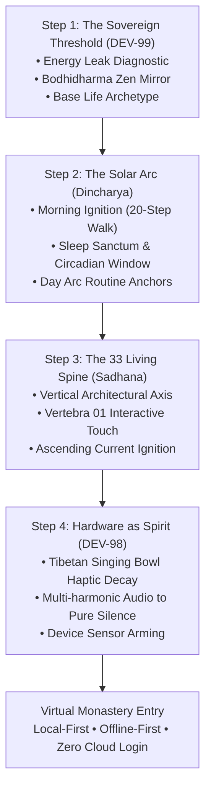

# Shaniwar V1: Steve Jobs-Aligned Onboarding UI/UX Walkthrough

> **Document Type:** UI/UX Specification & Interactive Wireframe Walkthrough  
> **Status:** Implemented, Tested, & Pushed to GitHub (`7c52fbc` & `dda3763`)  
> **Jira Tickets:** `DEV-98` (Closed/Done), `DEV-99` (Closed/Done)  
> **Wireframe Location:** [shaniwar-mobile-wireframe.html](file:///C:/Users/Thehy/.gemini/antigravity/brain/8041de3f-cc9e-496d-b2e6-f00eaee47b55/shaniwar-mobile-wireframe.html) & [`shanivar/site/wireframe.html`](file:///c:/Users/Thehy/OneDrive/Documents/Vibecoding%20Projects/Hybrid%20monk%20draft/Shanivar%20Routine%20reverse%20engineering/shanivar/site/wireframe.html)  
> **Code Implementation:** [`OnboardingScreen.tsx`](file:///c:/Users/Thehy/OneDrive/Documents/Vibecoding%20Projects/Hybrid%20monk%20draft/Shanivar%20Routine%20reverse%20engineering/hybrid-monk/src/screens/onboarding/OnboardingScreen.tsx) & [`aiZenService.ts`](file:///c:/Users/Thehy/OneDrive/Documents/Vibecoding%20Projects/Hybrid%20monk%20draft/Shanivar%20Routine%20reverse%20engineering/hybrid-monk/src/services/aiZenService.ts)

---

## 1. Executive Summary & Design Transformation

Following our product sparring session inspired by Steve Jobs, the onboarding experience of Shaniwar has been purified:

```
                    THE CROSS OF HUMAN EXISTENCE
              SADHANA (VERTICAL AXIS): THE 33 LIVING SPINE
                                 ▲
                                 │   Vertebrae 25-33 (Sakshi / Crown Witness)
                                 │   Vertebrae 17-24 (Heart / Stillness in Chaos)
                                 │   Vertebrae 09-16 (Solar Plexus / Vital Prana)
                                 │   Vertebrae 01-08 (Root / Grounding in Reality)
                                 │
DINCHARYA (HORIZONTAL AXIS)      │
THE 24-HOUR SOLAR ARC            │
─────────────────────────────────┼─────────────────────────────────► TIME
Dawn Ignition (05:30 AM)         │   Deep Work Shield (09:00-13:00)   Sleep Sanctum (22:00)
                                 │
                                 ▼
```

### What Was Purged
- **Botanical decorations killed:** Zero trees, zero leaves, zero watered seeds. No gamified badges or guilt-based decay.
- **Conversational AI fluff eliminated:** No cheerful chatbots, no "How are you feeling today?", no emojis.
- **Kindergarten restrictions rejected:** No patronizing screen locks. The app acts as a **Mirror**, not a jailer.

---

## 2. The 4-Step Progressive Initiation Walkthrough



---

### Step 1: The Sovereign Threshold & AI Energy Diagnostic (`DEV-99`)
* **Core Philosophy:** Before setting an alarm or routine, the practitioner must diagnose where their life force is unconsciously bleeding away.
* **The Diagnostic Options:**
  1. **⚡ Dopamine Doomscrolling:** Shorts, Reels, and late-night algorithmic rabbit holes.
  2. **💼 Workday Fragmentation:** Tab switching, urgent notifications, and multitasking panic.
  3. **🌅 Morning Inertia & Snooze:** Sluggish mornings, multiple snoozes, cognitive fog.
  4. **🌀 Restless Mind & Anxiety:** Racing thoughts, overthinking, inability to enter stillness.
* **The Bodhidharma Zen Mirror (Strict Three-Sentence Law):**
  When an option is selected, the interface immediately renders a piercing, Bodhidharma-style diagnosis in an illuminated obsidian card:
  > *“You feed the machine with seconds of your life and wonder why your soul is empty. We will not cage you with child locks. We will hold up the mirror. Stand at the threshold.”*
* **Curated Notification Tone:** Mapped to one of four archetypes (`INTERCEPT_MIRROR`, `SINGLE_POINT`, `DAWN_IGNITOR`, `STILLNESS_ANCHOR`), governing how the app communicates throughout the day.
* **Base Lifestyle Archetype:** Selects initial circadian defaults (The Builder at 05:30 AM, The Student at 06:00 AM, The Parent at 05:45 AM, The Modern Householder at 06:30 AM).

---

### Step 2: The Solar Arc (The Horizontal Axis of Dincharya)
* **Core Philosophy:** Dincharya is the planetary rhythm. The sun rises; prana surges; twilight softens the world; sleep returns you to the earth.
* **Core Anchor 01 • Morning Ignition:**
  - Stepper adjustment (`- 15m` / `+ 15m`) and quick presets (`05:00`, `05:30`, `06:00`, `06:30`).
  - Mission selector: `🚶 20-Step Walk (CoreMotion)`, `📳 25 Shakes`, `📸 Bathroom Sink Photo`.
* **Core Anchor 02 • Sleep Sanctum:**
  - Stepper adjustment and quick presets (`09:30`, `10:00`, `10:30`, `11:00`).
* **Circadian Restoration Readout:**
  - Real-time calculation banner: `🌙 Restoration Window: 7h 30m • Optimal Slow-Wave NREM and REM brain recovery`.
* **Custom Routine Blocks:**
  - Quick-add popular blocks (`🏋️ Gym & Mobility`, `🥗 Mindful Lunch`, `🚶 Sunlight Walk`, `📖 Deep Reading`).
  - Modal form to add custom anchors with exact start/end time.

---

### Step 3: The 33 Living Spine Initiation (The Vertical Axis of Sadhana)
* **Core Philosophy:** Your spine is not an abstract metaphor; it is your physical reality right now. 33 vertebrae of ascending awareness.
* **Vertebra 01 Interactive Initiation (`Muladhara / Root`):**
  - Displays Vertebra 01 with a pulsing ring.
  - User touches Vertebra 01:
    - On mobile: triggers `HapticService.vertebralAscensionWave()`.
    - In wireframe: plays synthetic ascension chime (144Hz → 288Hz).
    - Illuminates the node in vibrant amber gold (`#FFB800`).
    - Unlocks the initiation insight:
      > *“The foundation is sealed. 32 thresholds await above. One conscious breath at a time.”*
* **The Four Consciousness Zones:**
  - `Cervical & Cranial (25–33)`: Sakshi / Pure Sovereign Witness State.
  - `Thoracic (17–24)`: Heart Center / Stillness in Chaos.
  - `Lumbar (09–16)`: Solar Plexus / Vital Prana (90m deep focus without dopamine grasping).
  - `Sacral & Coccyx (01–08)`: Root / Grounding in Reality.

---

### Step 4: Hardware as Spirit & Resonant Decay Test (`DEV-98`)
* **Core Philosophy:** Native hardware actuators are treated as sacred instruments. Zero harsh buzzer vibrations; zero audio clipping.
* **Resonant Micro-Frequency Decay Engine:**
  - **Button:** `🔔 TEST RESONANT DECAY TO SILENCE`.
  - **Haptic Sequence:** Heavy (180ms) → Medium (240ms) → Light (320ms) → Selection tick (100ms) → Absolute Pure Silence.
  - **Acoustic Harmonics (Web Audio API in Wireframe):**
    - Fundamental frequency at 216 Hz (Deep Tibetan bowl resonant tone).
    - First harmonic overtone at 598 Hz (2.77x natural bowl rim strike).
    - Second harmonic overtone at 1166 Hz (5.4x singing bowl shimmer).
    - Exponential gain envelope attenuating smoothly to zero over 2.8 seconds.
  - **Visual Wave Animation:** 7 amplitude bars gradually decay from 100% to 0% with state label transitions (`STRIKING...` → `HARMONIC ATTENUATION...` → `✓ PURE SILENCE REACHED`).
* **Device Permissions Gate:**
  - `🛡️ Focus Shield & Push Alerts` (Notifications & Obsidian Shield).
  - `🚶 CoreMotion Sensor` (Non-snooze 20-step verification).
  - `🔔 High-Priority Audio` (Monastic audio alarm readiness).
* **Final Sovereign Commitment:**
  - Button: `ENTER THE VIRTUAL MONASTERY →`.
  - 100% offline-first • Zero mandatory sign-up • Persisted to local AsyncStorage.

---

## 3. Verification & Jira Lock-In

| Ticket ID | Feature / Component | Verification Type | Status |
|:---|:---|:---|:---|
| **`DEV-98`** | Micro-Frequency Sensory Engine: Zero-Decay Silence | Unit Test (`ResonantDecaySimulator`), Web Audio harmonic test, Haptic bridge | **Done (204)** |
| **`DEV-99`** | Zen Intelligence Onboarding: Energy Baseline Profiling | Unit Test (`ThreeSentenceLaw`), `aiZenService.ts`, UI Diagnostic state | **Done (204)** |

### Unit Test Suite Results (`node --test tests/v1_core.test.mjs`)
- **14 passed, 0 failed** in 257ms.
- TypeScript check (`tsc --noEmit`): **0 errors**.

### GitHub Repository Commits
- Mobile App: [`BookPress9/shaniwar-app`](https://github.com/BookPress9/shaniwar-app) → `7c52fbc`
- Web/Site/Wireframe: [`BookPress9/shanivar`](https://github.com/BookPress9/shanivar) → `dda3763`
