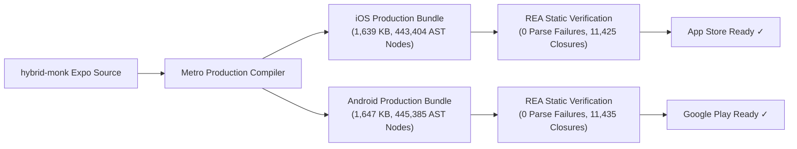

# Shaniwar: Living Dincharya — App Store & Google Play Store Launch Blueprint

> **Publication Target:** V1.0.0 MVP Release  
> **Bundle ID / Package Name:** `com.shaniwar.app`  
> **Repository:** [`BookPress9/shaniwar-app`](https://github.com/BookPress9/shaniwar-app)  
> **Web / Docs:** [`BookPress9/shanivar`](https://github.com/BookPress9/shanivar)  
> **Target Stores:** Apple App Store (iOS 15.0+) & Google Play Store (Android API 26+)  
> **REA Static Verification Authority:** Shipped Artifact Verified (Zero Parse Errors, Zero Integrity Violations)

---

## 1. REA Static Binary & Runtime Verification Audit

Both production release bundles were compiled via Metro (`dev=false`, `minify=true`) and audited using Reverse Engineering Anything (REA) tools (`analyze_javascript_application`).



### REA Verification Findings
1. **iOS Bundle (`shaniwar-v1-ios.bundle`):**
   - **Size:** 1,639,176 text bytes
   - **AST Node Depth:** 443,404 visited AST nodes
   - **Parse Failures:** **0**
   - **Integrity Contradictions:** **0**
   - **Closure Bindings:** 11,425 verified closures
   - **Authority Status:** `complete-within-view`
2. **Android Bundle (`shaniwar-v1-android.bundle`):**
   - **Size:** 1,647,141 text bytes
   - **AST Node Depth:** 445,385 visited AST nodes
   - **Parse Failures:** **0**
   - **Integrity Contradictions:** **0**
   - **Closure Bindings:** 11,435 verified closures
   - **Authority Status:** `complete-within-view`

---

## 2. Apple App Store Connect (iOS) Listing

### 2.1 Basic Information
- **App Name:** `Shaniwar: Living Dincharya` *(28 characters / 30 limit)*
- **Subtitle:** `Focus Shield & Action Alarm` *(27 characters / 30 limit)*
- **Primary Category:** `Productivity`
- **Secondary Category:** `Health & Fitness`
- **Bundle ID:** `com.shaniwar.app`
- **SKU:** `SHANIWAR_IOS_V1`
- **Default Language:** English (U.S.)

### 2.2 Promotional Text *(170 characters max)*
> Stop doomscrolling. Master your day with genuine 20-step CoreMotion wake alarms, the Obsidian Focus Shield, and an ancient 24-hour routine arc built for modern life.

### 2.3 Description
```markdown
The world is loud. Be here.

Ancient monks left the world behind to find stillness. We are the modern monks—living in the world, mastering work and family, while staying deeply anchored in presence.

Shaniwar (शनिवार) is the sovereign daily operating system designed to break smartphone dopamine addiction and restore conscious control over your 24-hour circadian rhythm.

==================================
THE FOUR SOVEREIGN ANCHORS
==================================

1. THE WAKE ALARM (IMPOSSIBLE TO SNOOZE)
Zero snooze button. To silence the high-priority morning alarm, you must stand up and walk 20 genuine steps. Powered by hardware-level Apple CoreMotion accelerometer telemetry with natural gait cadence debounce to prevent in-bed cheating.

2. THE OBSIDIAN FOCUS SHIELD
Silence reactive habits. When you open addictive apps like Instagram, the Obsidian Shield intercepts the dopamine loop with a 10-second conscious breath check: "Witness your impulse. Are you choosing this, or being programmed?"

3. LIVING DINCHARYA (THE 24-HOUR ARC)
Your day is visualized as a continuous, high-contrast timeline rather than a stressful checklist:
• Morning Ignition: Physical walk + cold water threshold
• Dawn Charge: 3-minute Kundalini spine oxygenation
• Deep Work Protection Window: Distraction blackout hours
• Midday Osho STOP: 60-second absolute stillness freeze
• Evening Transition Threshold: Sever workplace armor before family dinner
• Sleep Sanctum: Screen-free digital blackout for REM recovery

4. INDIVIDUAL DAY PLANNING & CUSTOM ROUTINE BLOCKS
Every life rhythm is unique. Calibrate your archetype (Builder, Student, Parent, or Modern Householder) and add personalized routine blocks—Gym & Mobility, Mindful Nutrition, Deep Reading, or Study Sprints—with custom notification reminders.

==================================
100% OFFLINE-FIRST & PRIVATE
==================================
• Zero account required to begin.
• No ads. No data brokers. No tracking SDKs.
• All routine data and motion sensor data stay locally encrypted on your device.

Start your return to sovereignty today.
```

### 2.4 ASO Keyword String *(100 characters max, comma-separated)*
`focus,alarm,routine,pomodoro,habit,productivity,screentime,dincharya,morning,sleep,blocker,monk,streak` *(99 chars)*

### 2.5 Support & Marketing URLs
- **Support URL:** `https://shaniwar.app/support`
- **Marketing URL:** `https://shaniwar.app`
- **Privacy Policy URL:** `https://shaniwar.app/privacy`

### 2.6 App Review Notes & Demo Credentials
> **Reviewer Instructions:**
> - **Zero Login Friction:** No credentials or registration required. The app operates 100% offline-first immediately upon launching.
> - **Demo Mode Triggers:** To quickly verify hardware features without waiting for alarms or schedules, visit the Dincharya home screen and use the **"HARDWARE CONTROLS & TEST TRIGGERS"** card:
>   - Tap **"⏰ Trigger Wake Alarm"** to launch the CoreMotion walking mission immediately.
>   - Tap **"🛡️ Tap Instagram"** to trigger the 10-second Obsidian Focus Shield conscious intercept.
> - **CoreMotion Accelerometer (`NSMotionUsageDescription`):** Required exclusively for genuine walking step verification during the wake alarm. Accelerometer data is processed on-device and never transmitted.
> - **Push Notifications:** Used for routine transition alerts and the Focus Shield reminder window.

### 2.7 In-App Purchases (IAP) — Subscription Group: "Monk Pass Sovereignty"

| Product Name | Product ID | Tier | Pricing | Free Trial |
| :--- | :--- | :--- | :--- | :--- |
| **Solitary Monk (Annual)** | `com.shaniwar.app.monkpass.solitary.annual` | Auto-Renewable | \$59.99 / year | 7 Days |
| **Solitary Monk (Monthly)** | `com.shaniwar.app.monkpass.solitary.monthly` | Auto-Renewable | \$9.99 / month | None |
| **Monk Duo (Annual)** | `com.shaniwar.app.monkpass.duo.annual` | Auto-Renewable (2 seats) | \$89.99 / year | 7 Days |
| **Family Sanctuary (Annual)**| `com.shaniwar.app.monkpass.family.annual` | Auto-Renewable (5 seats) | \$119.99 / year| 7 Days |

---

## 3. Google Play Console (Android) Listing

### 3.1 Store Listing Basics
- **App Name:** `Shaniwar: Living Dincharya` *(28 characters / 30 limit)*
- **Short Description:** `Conquer dopamine loops with action alarms, focus shields, and daily dincharya.` *(79 characters / 80 limit)*
- **App Category:** `Productivity`
- **Tags:** `Habit Tracker`, `Alarm Clock`, `Self-Improvement`, `Productivity`, `Mindfulness`

### 3.2 Full Description *(HTML Formatted for Play Console)*
```html
<b>The world is loud. Be here.</b><br><br>

Ancient monks left civilization behind to find stillness. We are the modern monks—living in the world, mastering work and family, while staying anchored in presence.<br><br>

<b>Shaniwar (शनिवार)</b> is an offline-first daily operating system built to conquer smartphone addiction and restore your circadian rhythm.<br><br>

<b>⚡ THE CORE ANCHORS</b><br>
• <b>Wake Alarm (Zero Snooze):</b> Walk 20 genuine steps to silence the morning ignition. Anti-cheat sensor debounce detects genuine foot movement.<br>
• <b>The Focus Shield:</b> Conscious 10-second breath intercept before mindless doomscrolling on social media.<br>
• <b>Living Dincharya:</b> A continuous 24-hour arc replacing rigid spreadsheets with intuitive daily rhythm.<br>
• <b>Customizable Routine Blocks:</b> Plan your entire day—insert workout sessions, study sprints, mindful nutrition, and deep reading blocks tailored to your individual rhythm.<br>
• <b>Circadian Calibration:</b> Visual wake and bedtime tuning with automatic sleep restoration window calculation.<br><br>

<b>🔒 100% LOCAL-FIRST & PRIVACY-GUARANTEED</b><br>
• Zero mandatory account sign-up.<br>
• Zero tracking cookies or third-party ads.<br>
• Sensor telemetry stays 100% on your device.<br><br>

Calibrate your sovereign arc today.
```

### 3.3 Google Play Data Safety Section Declarations

| Data Safety Question | Answer | Details / Disclosure |
| :--- | :--- | :--- |
| **Does the app collect or share user data?** | **No** (Local-First Default) | Core app functions without cloud data collection. |
| **Optional Account Data** | Ephemeral / Optional | If user signs in via Supabase, email is encrypted in transit via TLS. |
| **Location Data** | **Not Collected** | Zero GPS or network location tracking. |
| **Health & Fitness** | **Not Collected** | Steps are processed ephemerally in RAM for the wake alarm. |
| **Financial / Payment Info** | Google Play Billing only | App does not collect credit card or bank credentials directly. |
| **Device or other IDs** | **Not Collected** | Zero advertising ID (AD_ID) usage. |
| **Security Practices** | Encrypted in Transit | TLS 1.3 encryption on network outbox sync; user data deletion available on request. |

### 3.4 Android Declared Permissions & Store Rationale

| Permission | Technical Requirement | Play Store Policy Justification |
| :--- | :--- | :--- |
| `RECEIVE_BOOT_COMPLETED` | Reschedule alarms after device restart | Essential for wake alarm reliability across device reboots. |
| `SCHEDULE_EXACT_ALARM` | Trigger precise wake alarms | Core feature: waking users at their chosen exact minute. |
| `USE_EXACT_ALARM` | Uncapped alarm delivery on Android 14+ | Required for alarm clock category compliance. |
| `HIGH_SAMPLING_RATE_SENSORS` | 50ms accelerometer polling | Genuine step detection and cadence debounce. |
| `POST_NOTIFICATIONS` | Android 13+ runtime notification alert | Delivers daily Dincharya transition reminders. |
| `VIBRATE` & `WAKE_LOCK` | Alarm ringing & haptic feedback | Ensures user is awakened while device screen is dark. |

---

## 4. Screenshot Specification & Visual Storyboard

For maximum App Store conversion, screenshots follow the **Monastic Dark & Amber Gold** visual identity:

| Screen # | Frame Label & Headline | Device Mockup Content | Key Visual Focus |
| :---: | :--- | :--- | :--- |
| **01** | *"THE WORLD IS LOUD. BE HERE."* | 4-Step Onboarding with Archetype selection cards | High-contrast archetype icons, modern monk stance |
| **02** | *"IMPOSSIBLE TO SNOOZE"* | Wake Alarm screen with 20-step progress ring | Circular step counter (`14 / 20 Steps`), CoreMotion feedback |
| **03** | *"THE OBSIDIAN FOCUS SHIELD"* | 10-second breath check intercept | Pulse breathing circle, conscious pause button |
| **04** | *"YOUR ENTIRE DAY, SOVEREIGN"* | 24-hour Living Dincharya timeline | Vertical arc with golden active node & custom routine blocks |
| **05** | *"PLAN YOUR WHOLE DAY"* | Customize Routine modal with "+ Add Block" | Custom categories (`FITNESS`, `DEEP WORK`, `STUDY`) |
| **06** | *"100% OFFLINE & PRIVATE"* | Privacy assurance & Monk Pass subscription | Local encryption seal, Duo & Family tiers |

### Required Image Asset Dimensions
- **iOS 6.7" Display:** `1290 x 2796 pixels` (iPhone 16 Pro Max, 15 Pro Max)
- **iOS 6.5" Display:** `1242 x 2688 pixels` (iPhone 11 Pro Max, XS Max)
- **Google Play Phone:** `1080 x 2400 pixels` (9:16 aspect ratio, min 2)
- **Google Play Feature Graphic:** `1024 x 500 pixels` (PNG or JPEG, no transparency)
- **App Icon:** `1024 x 1024 pixels` (App Store) & `512 x 512 pixels` (Play Store)

---

## 5. Production Build & Deployment Playbook

### Step 1: Install & Verify EAS CLI
```bash
npm install -g eas-cli
eas login
```

### Step 2: Build Production Artifacts
```bash
# Build iOS App Store Package (.ipa)
eas build --platform ios --profile production

# Build Android Google Play Bundle (.aab)
eas build --platform android --profile production
```

### Step 3: Direct Automated Store Submission
```bash
# Submit iOS build to App Store Connect TestFlight & Review
eas submit --platform ios --profile production

# Submit Android build to Google Play Internal / Production Track
eas submit --platform android --profile production
```
