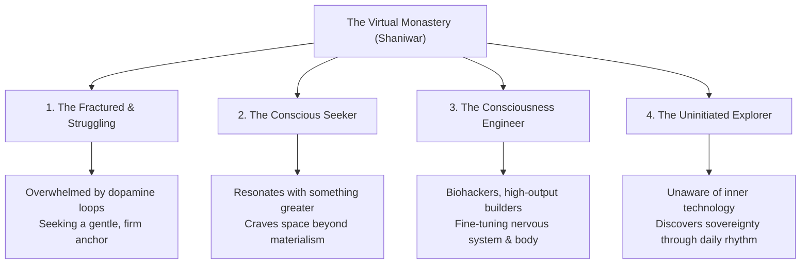
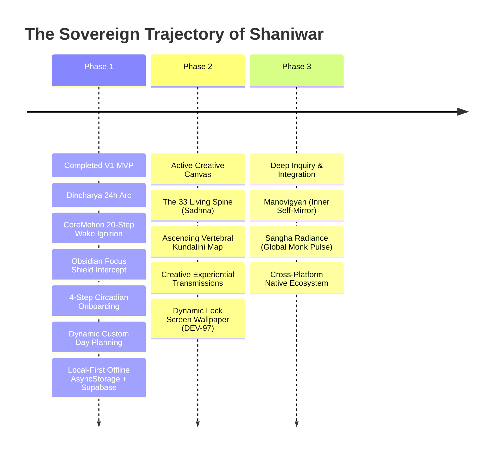

# Shaniwar (शनिवार) — The Virtual Monastery & The Hybrid Monk Manifesto

> **Document Type:** Founding Vision & Philosophical Baseline  
> **Status:** Active North Star  
> **Author & Visionary:** The Hybrid Monk  
> **Project:** Shaniwar / Shanivar Ecosystem  
> **Repositories:** [`BookPress9/shaniwar-app`](https://github.com/BookPress9/shaniwar-app) • [`BookPress9/shanivar`](https://github.com/BookPress9/shanivar)

---

```
        “The world is loud. Be here.
         Ancient monks left the world behind to find stillness.
         We are the modern monks—living in the world,
         mastering the world, staying anchored in presence.”
```

---

## Part I: The Core Thesis & Genesis

### 1. The Paradox of the Modern Age
Humanity has crossed an unprecedented threshold. Technological advances are no longer merely tools aiding human action; they are accelerating faster than the evolution of the biological human nervous system. We live surrounded by hyper-engineered comfort, immediate sensory gratification, predictive algorithms, and infinite digital feeds. 

Yet, beneath this synthetic convenience lies an unspoken crisis: **the hollowing out of the human life force.** Attention is fractured. The connection to the physical body has atrophied into screen-gazing lethargy. The mind is perpetually stimulated, yet the soul feels profoundly untethered.

### 2. Why the Cave is Obsolete: The Hybrid Monk
Throughout history, the classical response of the spiritual seeker was renunciation: retreat to the mountain, the forest, or the monastery cave. 

In the 21st century, retreating to a cave is an evasion, not a solution. Technological evolution cannot be halted, nor should it be. It is an intrinsic chapter in the unfolding cosmos. The world is moving inexorably forward, and our role is not to wage an impossible war against technology, but to master ourselves within it.

This is the genesis of the **Hybrid Monk**:
* A practitioner who lives in the center of the world, not on its fringes.
* An engineer, creator, student, or parent who utilizes modern silicon, high-yield tools, and computational power.
* An individual so deeply grounded in their own inner core that they **experience the matrix through their own conscious sovereign authority**.

You do not allow the matrix to dictate your desires, program your anxieties, or harvest your dopamine. Instead, you stand centered at your core, exercising the sovereign freedom to accept, reject, or engage with the digital landscape entirely on your own terms.

### 3. The Virtual Monastery
Shaniwar is not merely another "productivity tracker," "habit app," or "alarm clock." Those categories represent transactional software. 

**Shaniwar is a Virtual Monastery.**

A virtual monastery is a consecrated digital sanctuary in cyberspace. It provides a sacred container where anyone, at any hour of the day, can step off the treadmill of societal noise, enter a protected focus block, drop into stillness, and get to know their own true essence. This is not novel—monasteries, ashrams, and silent orders have served this purpose for millennia. What is revolutionary is embedding this ancient sanctuary into the very device that typically distracts: the smartphone in the pocket of modern humanity.

---

## Part II: The Audience & The Spectrum of Seekers

The Virtual Monastery opens its gates to a wide, multifaceted human spectrum:



1. **The Fractured & Struggling:** Those caught in doomscroll paralysis, burnout, screen fatigue, and sleep deprivation. They do not need complicated lectures; they need a clean, non-punitive container that helps them stand up in the morning and breath during the day.
2. **The Conscious Seeker:** Individuals who instinctively know that human life is larger than spreadsheets, salaries, and social media likes. They seek spaces where they can feel the vastness of being.
3. **The Consciousness Engineer:** Builders, biohackers, and founders who view the mind, nervous system, and physical body as precision instruments to be mastered, energized, and brought to peak clarity.
4. **The Uninitiated:** The everyday person who downloaded an alarm or a focus tool simply to wake up on time, but through experiential immersion, discovers an entire universe of inner stillness and conscious autonomy.

---

## Part III: The Architecture of Sovereignty — How Far We Have Come

To bring a virtual monastery into reality, we began not with abstract theory, but with the foundation of daily reality: **Dincharya (The Day Arc).**



### 1. What Has Been Built (The Bedrock)
* **The Living Dincharya (24-Hour Circadian Arc):** Replaced cold, fragmented to-do tables with a continuous, living arc that adapts to individual archetypes (Builder, Student, Parent, Modern Householder).
* **The Morning Ignition (Zero-Snooze Wake Verification):** Silencing the morning call requires physical proof of life—20 genuine footsteps verified by Apple CoreMotion accelerometer telemetry with natural gait cadence debounce. No frantic math problems; pure embodied wakefulness.
* **The Obsidian Focus Shield (Conscious Intercept):** An automatic pause before entering mindless digital channels (like Instagram). It does not punish; it holds up a 10-second conscious breath mirror: *"Witness your impulse. Are you choosing this, or being programmed?"*
* **4-Step Circadian Calibration & Custom Day Planning:** Allows every practitioner to calibrate their unique wake time, sleep sanctum, and insert personalized routine blocks (Gym, Deep Reading, Sunlight Walk, Family Presence) to craft their life as a conscious work of art.
* **Local-First Sovereign Architecture:** 100% functional offline. Zero mandatory accounts. Zero tracking trackers. Encrypted locally on-device via AsyncStorage before optional outbox synchronization.
* **Decoupling of Dogma:** Deliberately removed rigid denominational anchors (such as NaamJapa) from V1 to preserve Shaniwar as a universal, neutral, experiential sanctuary open to every human soul.

---

## Part IV: The Creative Horizon — The 33 Living Spine

With the grounding bedrock of Dincharya locked and tested, the next creative frontier of the Virtual Monastery is **The 33 Living Spine (Sadhna)**.

```
       (Cervical: C1-C7)  ─── Transcendent Clarity & The Witness
              ▲
       (Thoracic: T1-T12) ─── The Heart, Courage & Emotional Resilience
              ▲
       (Lumbar: L1-L5)    ─── Vitality, Life Force & Physical Action
              ▲
       (Sacral & Coccyx)  ─── Grounding, Survival & Circadian Foundation
```

### The Concept & The Visionary Canvas
The human spine has 33 vertebrae—from the coccyx at the base of the physical vessel to the atlas supporting the cranial dome. In ancient yogic physiology, this is not merely an anatomical column of bone and cartilage; it is the **Sushumna Nadi**, the central highway through which human life force (Prana, Kundalini, Chi) ascends.

As Shaniwar evolves, the **33 Living Spine** is the sacred creative canvas where the founder's deepest personal experiences, meditations, and realizations will be poured:

1. **Not a Generic Habit Streak:** While other apps show a cartoon tree or a streak number, Shaniwar maps the practitioner's inner evolution onto the living spine.
2. **Ascending Stages of Awakening:**
   * **Base Anchors (Vertebrae 1–8):** Grounding, nervous system calming, breaking circadian chaos, mastering breath ratio (Box Breathing, Coherence).
   * **Core Power (Vertebrae 9–16):** Pranic ignition, conquering fatigue, diaphragmatic strength, Kundalini awakening breath.
   * **Heart & Stillness (Vertebrae 17–24):** Emotional de-armoring, the Osho STOP technique, witness consciousness amidst daily chaos.
   * **Higher Clarity & Sovereignty (Vertebrae 25–33):** The Witness State (Sakshi), pure awareness, viewing the matrix from unbroken equanimity.
3. **A Creative Reservoir of Lived Insight:** Every breath exercise, prompt, and contemplative transmission within this journey will reflect genuine, battle-tested human insight, rather than dry academic meditation scripts.

---

## Part V: The Non-Negotiable North Stars

As Shaniwar scales from an initial release to a global movement, the following principles remain non-negotiable:

| Principle | The Rule | Why It Matters |
| :--- | :--- | :--- |
| **1. The Human Stance First** | Technology must serve the human spirit, never the reverse. | If an algorithmic notification or feature creates anxiety, it violates the monastery's essence. |
| **2. Experiential, Not Dogmatic** | No dogma, no mandatory spiritual labels. | True knowledge arises automatically from direct inner stillness. We provide the room; the user experiences their core. |
| **3. Respect for the Life Force** | Physical movement & breath over abstract theory. | Waking requires feet on the earth. Calming requires air in the lungs. Sovereignty is embodied. |
| **4. Dignified Aesthetics** | Monastic dark, obsidian, amber gold, and sacred silence. | The visual environment must feel like entering a serene stone temple at dawn, far removed from neon dopamine slots. |
| **5. Absolute Privacy & Local Sovereignty** | Local-first by default; zero surveillance capitalism. | A monastery is a sanctuary. What a practitioner practices in their sanctuary belongs exclusively to them. |

---

## Conclusion: The Lived Reality

Shaniwar is not an intellectual concept. It is a daily lived discipline. 

By waking with intention, protecting our focus from unconscious loops, breathing into the living spine, and consciously setting down the armor of work at dusk, we prove that it is possible to live in the modern world without becoming its servant.

We are the modern monks.  
We live in the world.  
We master the world.  
We remain anchored in our core.
