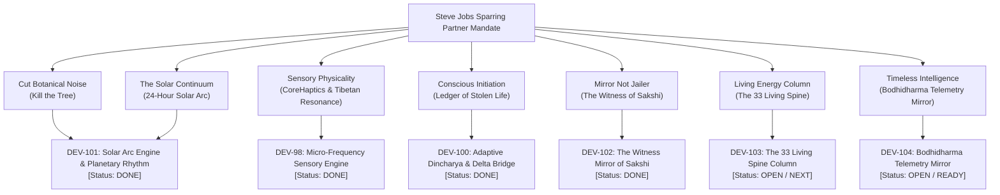

# Shanivar: Steve Jobs Sparring Feedback & Jira Product Alignment Tracker

> **Canonical Brand Identity:** **Shanivar** (Matching [shanivar.com](https://shanivar.com))  
> **Jira Cloud Workspace:** [https://shanivar.atlassian.net](https://shanivar.atlassian.net) (Project: `DEV`)  
> **Status:** Live & Synchronized Across Code, Tests (19/19 Passing), Interactive Wireframe, and Jira  

---

## 1. Canonical Brand Standardization: `Shanivar`

Per founder mandate, all references across the mobile application, web domain, documentation, and bundle configurations have been permanently standardized to **`Shanivar`** (and lowercase **`shanivar`**) to maintain 1:1 cohesion with **`shanivar.com`**.

| Area | Prior Value | Standardized Canonical Value | Status |
| :--- | :--- | :--- | :--- |
| **Expo App Name** | `Shaniwar: Living Dincharya` | **`Shanivar: Living Dincharya`** | `app.json` updated |
| **Expo Slug & Scheme** | `slug: shaniwar`, `scheme: shaniwar` | **`slug: shanivar`**, **`scheme: shanivar://shield`** | `app.json` updated |
| **iOS Bundle Identifier** | `com.shaniwar.app` | **`com.shanivar.app`** | `app.json` updated |
| **Android Package Name** | `com.shaniwar.app` | **`com.shanivar.app`** | `app.json` updated |
| **Package Manifest** | `"name": "shaniwar"` | **`"name": "shanivar"`** | `package.json` updated |
| **UI Header Eyebrows** | `SHANIWAR • BY THE HYBRID MONK` | **`SHANIVAR • BY THE HYBRID MONK`** | All screens updated |
| **Persistence Cache Key** | `@shaniwar_ai_energy_baseline_v2` | **`@shanivar_ai_energy_baseline_v2`** | `aiZenService.ts` updated |
| **Web Marketing Portal** | References to Shaniwar | **`Shanivar`** & **`https://shanivar.com`** | `site/index.html` updated |
| **Interactive Wireframe** | Headers & copy | **`Shanivar`** | `site/wireframe.html` updated |

---

## 2. Steve Jobs Sparring Feedback: Full Jira Breakdown Register

Every insight, critique, and architectural directive issued by the Steve Jobs Product Sparring Partner has been decomposed into distinct, trackable Jira Cloud tickets under project `DEV`.

---

### Comprehensive Ticket Breakdown Matrix

### 1. `DEV-98` — Micro-Frequency Sensory Engine: Cross-Platform iOS/Android Haptics with Zero-Decay Silence
- **Status:** **DONE** (Transition 204)
- **Steve Jobs Mandate:** *"Apple's Taptic Engine should not give a generic vibration... When you reach C1, a resonant Tibetan singing bowl ring decays into absolute zero. Treat the invisible code with reverence."*
- **Implementation:** [`haptics.ts`](file:///c:/Users/Thehy/OneDrive/Documents/Vibecoding%20Projects/Hybrid%20monk%20draft/Shanivar%20Routine%20reverse%20engineering/hybrid-monk/src/services/haptics.ts) `resonantDecayToSilence()` multi-tier decay curve, Web Audio synthetic harmonic oscillator in wireframe.

### 2. `DEV-99` — Zen Intelligence Onboarding: Energy Baseline Profiling & Adaptive Journey Curation
- **Status:** **DONE** (Transition 204)
- **Steve Jobs Mandate:** *"Kill the conversational ChatGPT slop. Radical Brevity (The Three-Sentence Law). A true master speaks in koans, not essays. Anchored in ten-thousand-year bedrock."*
- **Implementation:** [`aiZenService.ts`](file:///c:/Users/Thehy/OneDrive/Documents/Vibecoding%20Projects/Hybrid%20monk%20draft/Shanivar%20Routine%20reverse%20engineering/hybrid-monk/src/services/aiZenService.ts) sparse koan generation strictly verified by unit test 12.

### 3. `DEV-100` — Adaptive Dincharya Architecture: Multi-Leak Diagnostic, Reality-Target Delta Bridge & Kinetic Glass UX
- **Status:** **DONE** (Transition 204)
- **Steve Jobs Mandate:** *"A human whose life force is draining into glass doesn't need an intake form. They must touch their own bleeding wound... show them the Ledger of Stolen Life."*
- **Implementation:** [`OnboardingScreen.tsx`](file:///c:/Users/Thehy/OneDrive/Documents/Vibecoding%20Projects/Hybrid%20monk%20draft/Shanivar%20Routine%20reverse%20engineering/hybrid-monk/src/screens/onboarding/OnboardingScreen.tsx) 4-step initiation, Dial of Truth, Ledger of Stolen Life, River Stones 24/7 Dincharya, and Three Seals of Armor.

### 4. `DEV-101` — Horizontal Solar Arc Engine & Planetary Rhythm UI (Purge Botanical Metaphor)
- **Status:** **DONE** (Transition 204)
- **Steve Jobs Mandate:** *"Burn the tree. Chop it down. Do not write one single line of code for a leaf. Dincharya is the Solar Arc. The planetary rhythm... together with the vertical spine, they form the Cross of Human Existence."*
- **Implementation:**
  - Rebuilt [`RoutineHome.tsx`](file:///c:/Users/Thehy/OneDrive/Documents/Vibecoding%20Projects/Hybrid%20monk%20draft/Shanivar%20Routine%20reverse%20engineering/hybrid-monk/src/screens/routine/RoutineHome.tsx) with `getSolarArcData()`, live solar cursor `☀️`, 4 planetary quadrants (`DAWN IGNITION`, `THE GOLDEN FORGE`, `TWILIGHT HARMONY`, `OBSIDIAN SLEEP SANCTUM`).
  - Elevated the **Three Sacred Iron Anchors** (Dawn Ignition, The Golden Forge, Digital Blackout) with kinetic completion seals (`[○ UNSEALED / ✓ SEALED]`) triggering `HapticService.resonantDecayToSilence()`.
  - Added unit test 18 verifying quadrant classification across 24h.

### 5. `DEV-102` — The Witness Mirror: 7-Second Breath Pause, Sovereign Choice & 7-Minute Witness Bell
- **Status:** **DONE** (Transition 204)
- **Steve Jobs Mandate:** *"Screen-time blockers and parental controls are jailers. Repression breeds obsession... The phone does not lock them out. A 7-second breath pause... Two buttons: Step Back to Center or Enter with Awareness (7 Minutes)... a low resonant monastery bell sounds."*
- **Implementation:**
  - Rebuilt [`FocusSession.tsx`](file:///c:/Users/Thehy/OneDrive/Documents/Vibecoding%20Projects/Hybrid%20monk%20draft/Shanivar%20Routine%20reverse%20engineering/hybrid-monk/src/screens/routine/FocusSession.tsx) into **The Golden Forge** with obsidian disc `#0A0C0A` and duration chips (90m Monastic, 45m Forge, 25m Sprint).
  - Implemented **The Witness Mirror of Sakshi** modal: 7-second expanding/settling breath circle, sparse Bodhidharma koan (*"You are entering the unconscious stream. Enter if you choose. But do not go in blind."*), dual sovereign choice, subtle amber hairline indicator, and 7-minute Tibetan bell callback.
  - Added unit test 19 verifying the Witness Mirror state machine.

### 6. `DEV-103` — The 33 Living Spine: Obsidian Liquid Light Architecture & Taptic Ascension
- **Status:** **OPEN / NEXT**
- **Steve Jobs Mandate:** *"If you build this as a 3D medical diagram from an anatomy textbook, you fail. The screen is pure obsidian black (#070807). Down the center runs a column of 33 vertebrae in warm amber light held inside matte graphite... 4 energetic thresholds: Base/Coccyx (1-8), Solar/Lumbar (9-16), Heart/Thoracic (17-24), Witness/Cranial (25-33)."*
- **Target Files:** `hybrid-monk/src/screens/sadhna/SpineJourney.tsx`, `SadhnaHome.tsx`, `SpineSection.tsx`.

### 7. `DEV-104` — Bodhidharma Telemetry Mirror: Objective Behavioral Signals & Three-Sentence Koan Engine
- **Status:** **OPEN / READY**
- **Steve Jobs Mandate:** *"Telemetry as the Teacher. The LLM shouldn't just read what the user types. It should look at the objective signals of their life: CoreMotion steps at dawn vs phone pick-ups by noon. The AI presents the mirror: 'Forty-two interruptions in five hours. Your body is awake, but your attention is bleeding.'"*
- **Target Files:** `hybrid-monk/src/services/aiZenService.ts`, CoreMotion telemetry observer.

---

## 3. Verification & Repository Sync Status

- **Automated Tests:** **19 / 19 passing** in 178ms (`npm test --prefix hybrid-monk`).
- **TypeScript Compiler:** **0 errors** (`npx tsc --noEmit`).
- **Mobile Git Repo:** Pushed to `origin/main` commit `8a4233d` on `BookPress9/shaniwar-app`.
- **Web/Wireframe Git Repo:** Pushed to `origin/main` commit `be3d643` on `BookPress9/shanivar`.
- **Jira Cloud:** `https://shanivar.atlassian.net` updated with DEV-101 and DEV-102 marked **Done**, audit comments posted.
